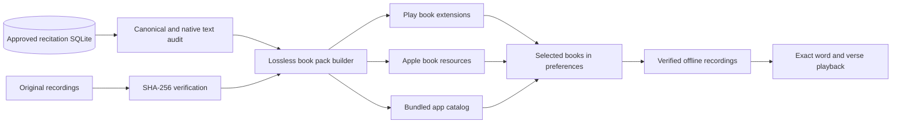

# Recitation extension delivery

Recitation is independent of the Perushim notes extension. Preferences lets readers
select whole books or all available books and shows each book's download size.
Android downloads `recitation_<seferId>` on-demand Play Asset Delivery modules.
iOS downloads the corresponding Apple-hosted managed asset packs through the same
delivery service used by Perushim. Playback never downloads an MP3 or catalog from
S3 or the website.

The catalog is bundled with the application. Its exact canonical words and approved
timings come from the durable recitation SQLite database, audited against the
canonical JSON and native Bible database. Held chapters have no word intervals;
they can play their full recording. Newly approved timings reach the app through
an app release, just like changes to the Perushim extension.

`prepare_recitation_assets.py --platform Android` (or `iOS`, `Windows`) creates
the release assets. Mobile store packs use the verified, immutable Ogg Opus
playback files; Windows uses the original MP3s. `--recordings <directory>` can
supply these files locally; otherwise **the build** fetches verified assets from
the source URLs. Its hash cache is resumable. ZIP packages preserve the audio bytes
without re-encoding, and repeated generation produces identical archives. Native
packaging invokes this preparation before evaluating the app project.

## Local development

Run `bun run --cwd devops setup_dev_env` from the repository root. During app
setup it prompts for the recordings directory, defaulting to
`~/git/tanah-s3/recordings` under the current user's home directory. Press Enter to
accept, or enter a directory containing the original `<perekId>_record.mp3` files.
The selection is saved as `RECITATION_RECORDINGS_PATH` in the ignored
`app/.dev.env.local`; the environment variable of the same name takes precedence.
Setup prepares the Android catalog and book packs alongside the Perushim assets.

To change only this setting, run `node devops/local-recitation.mjs configure`.
For noninteractive setup, set `RECITATION_RECORDINGS_PATH` or pass
`--recordings <directory>`. Relative paths resolve from the repository root.

The app's NUKE `RunAndroid`, `RunWindows`, `Dev`, `RunIos` and `RunMac` targets
prepare their platform's catalog and packs before building, including Android
watch mode. They use `--local-originals` to package the verified local MP3s
without requiring the store playback files or network access. Missing recordings
or mismatched hashes fail preparation rather than silently building an empty
catalog. For a direct `dotnet build`, first run:

```sh
node devops/local-recitation.mjs prepare --platform Android
```

Use `Windows` or `iOS` for the other platforms. Prepare immediately before building
that platform because the bundled catalog describes its generated packs. Debug
mobile builds embed the packs, so the extension preferences can install individual
books or all recordings without a store connection, using the normal verified
import flow. Generated catalogs, audio packs and local settings stay out of Git.
Store packaging continues to use its release preparation and on-demand delivery.

The app validates the archive hash and its complete inventory before importing
audio. Every recording must also match its catalog playback SHA-256 before an atomic
replacement. Completed recordings survive cancellation and app updates. Existing
downloads from the previous service are reused when their hashes still match.
After import, audio lives in persistent application storage and works offline;
the operating system may independently purge its temporary delivery cache.

Windows ships the same archives as application assets because the existing
delivery service has no Windows on-demand provider. Sideloaded Android Debug
builds also embed the archives for testing without Play. Mobile store Release
builds keep the audio out of the base installation.

CI generates real book packages, builds an Android release bundle, and checks
every module and archive hash. Store packaging also rejects an IPA without the
embedded downloader extension, an asset-pack manifest, or a matching `.aar`
payload. Generated audio stays out of Git.


