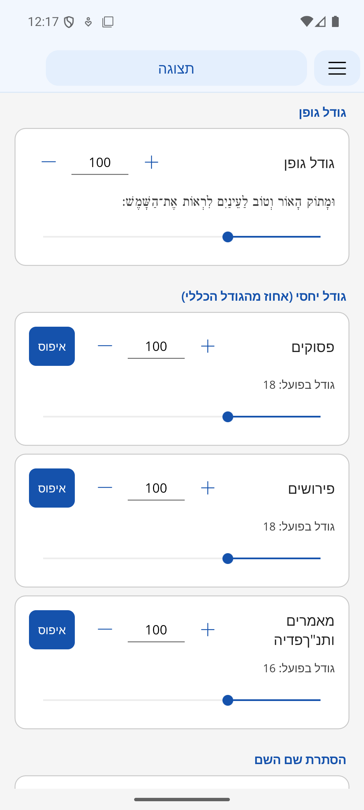
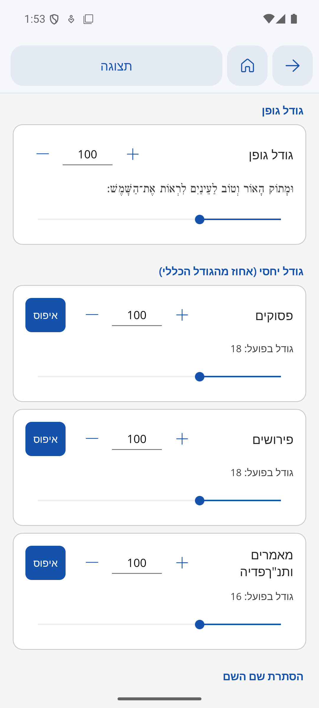
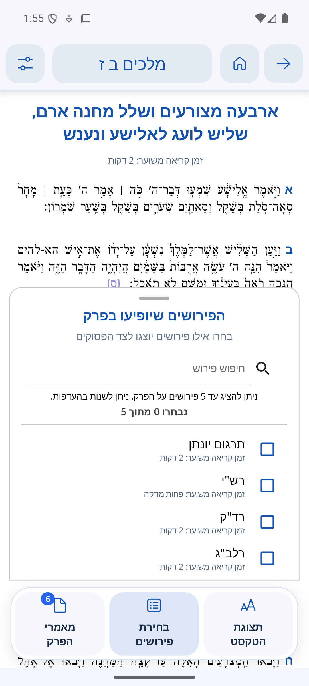
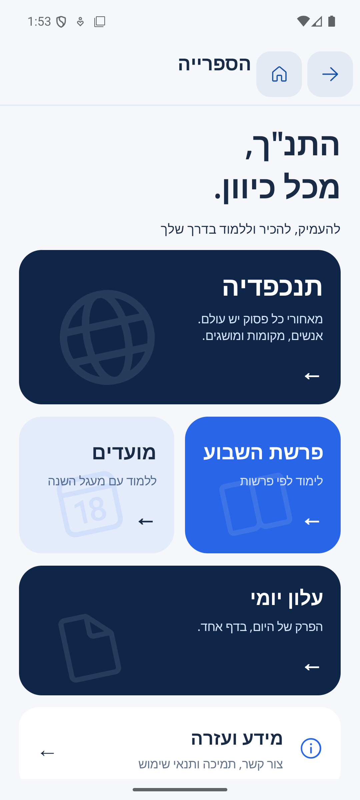
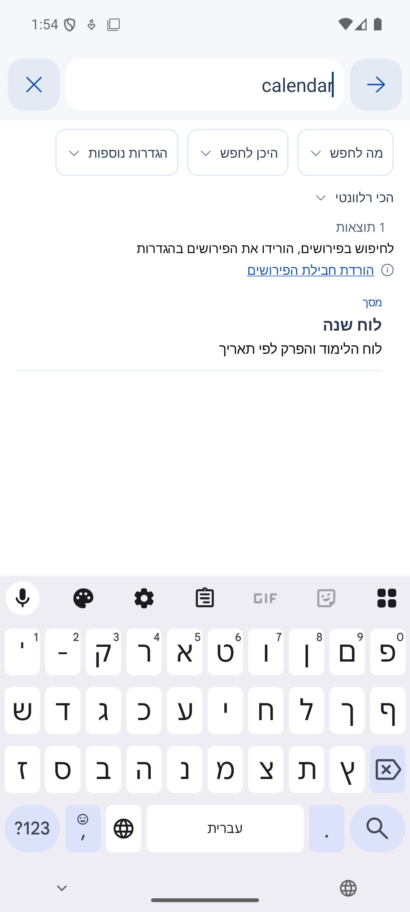
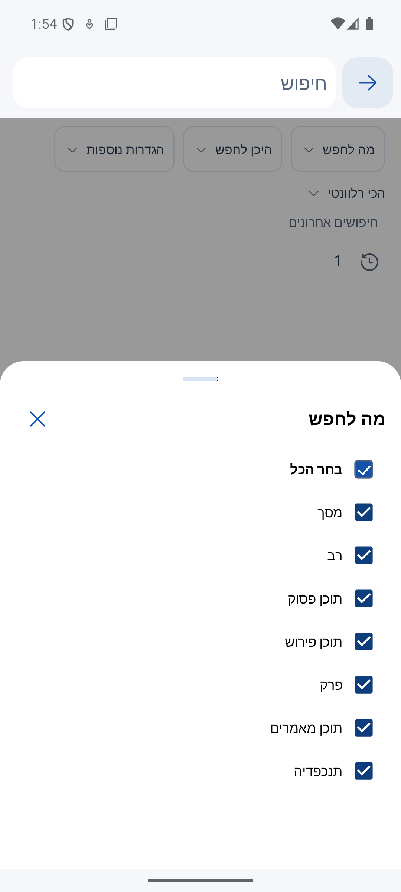
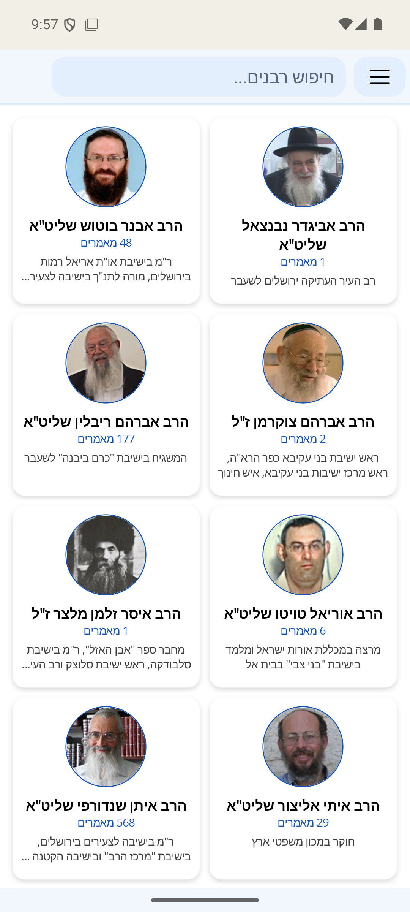
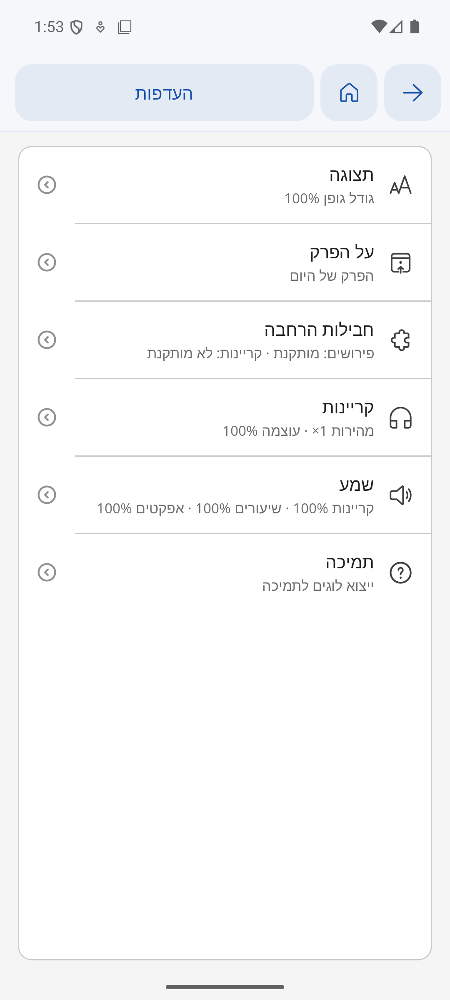

# על הפרק - לפני ואחרי מול הענף הראשי

ענף ביקורת מתמשך. ה-PR נשאר בטיוטה. אין למזג או להפעיל מיזוג אוטומטי בלי הוראה מפורשת מדורד.

[PR #3385](https://github.com/bible-on-site/bible-on-site/pull/3385) · [גלריית HTML בדפדפן](index.html) · [המסכים הנוכחיים](current.html)

כל צילומי ה"לפני" הם מהענף הראשי של המאגר, ולא מאיטרציות קודמות בענף ה-UX. מימין: המצב הקיים. משמאל: ההצעה הנוכחית. כל הצילומים והסרטונים נלקחו מהאפליקציה האמיתית באמולטור Android.

בסיס צילומי "לפני": `master / 95c202eb5`. עודכן: 2026-11-15.

הכרטיס היומי נשאר במרכז הבית. הספרייה היא מסך נוסף. צילומי "אחרי" מתעדכנים באותם שמות קבצים; היסטוריית האיטרציות נשמרת ב-Git.

GitHub מציג את ה-Markdown כתוכן מעוצב ותומך ב-rich diff ב-Files changed. ה-HTML נשמר כקוד ונפתח מקומית עם קובצי ה-CSS וה-assets.

## כניסה לאפליקציה - הפרק היומי במרכז

ב-master הכניסה היא ישירות לפסוקי הפרק. בהצעה החדשה נכנסים לבית עם כרטיס הפרק היומי הכהה, הכותרת הגדולה והכפתור הכחול. הכרטיס נשמר; הספרייה היא מסך נוסף ולא תחליף לבית.

<table dir="rtl">
<thead><tr><th align="right">לפני - הענף הראשי</th><th align="right">אחרי - הצעת UX</th></tr></thead>
<tbody><tr>
<td align="right"> הכניסה הקיימת: ישירות לקורא</td>
<td align="right"> הבית החדש עם כרטיס הפרק היומי</td>
</tr></tbody></table>

## מגלים עוד - בלי רשימת קישורים קטנים

במקום להגיע לכל יעד דרך מגירת הניווט, הבית מציג את הכניסות המרכזיות בכרטיסים גדולים. מסורה היא חלוקה מסורתית; רבנים וכותבים והספרייה מקבלים כניסות מובחנות.

<table dir="rtl">
<thead><tr><th align="right">לפני - הענף הראשי</th><th align="right">אחרי - הצעת UX</th></tr></thead>
<tbody><tr>
<td align="right"> מגירת הניווט ב-master</td>
<td align="right"> הכניסות בהמשך הבית</td>
</tr></tbody></table>

## כלים שמשנים את הקריאה - עם שמות של פעולות

תצוגת הטקסט פותחת גודל גופן ותצוגה. בחירת פירושים קובעת אילו פירושים יוצגו לצד הפסוקים. מאמרי הפרק פותחים תוכן נוסף, עם מונה נפרד. הכפתורים אינם מוצגים כשלוש לשוניות ניווט מקבילות.

<table dir="rtl">
<thead><tr><th align="right">לפני - הענף הראשי</th><th align="right">אחרי - הצעת UX</th></tr></thead>
<tbody><tr>
<td align="right"> הקורא ופס האייקונים הקיים</td>
<td align="right"> פעולות מפורשות וכפתורים גדולים</td>
</tr></tbody></table>

## גלילה - אזור הקריאה נשאר יציב

בכניסה שני הסרגלים גלויים. כל גרירה משאירה אותם גלויים או מחזירה אותם מיד. אחרי סיום הגרירה ו-1.8 שניות ללא פעילות, העליון מחליק למעלה והתחתון דועך. אזור הקריאה שומר על גודל קבוע.

<table dir="rtl">
<thead><tr><th align="right">לפני - הענף הראשי</th><th align="right">אחרי - הצעת UX</th></tr></thead>
<tbody><tr>
<td align="right"> הקורא הקיים אחרי גלילה</td>
<td align="right"> הגלילה בהצעת ה-UX</td>
</tr></tbody></table>

## אפשרויות הקריאה - גיליון נוח ללחיצה

שניים מקרא, תיקון קוראים והסתרת שם השם מוצגים בגיליון בגודל התוכן. חיפוש פותח את החיפוש הקיים. אין כפתור מסך מלא: הסרגלים נעלמים אוטומטית אחרי גרירה והשהיה.

<table dir="rtl">
<thead><tr><th align="right">לפני - הענף הראשי</th><th align="right">אחרי - הצעת UX</th></tr></thead>
<tbody><tr>
<td align="right"> התפריט הקטן ב-master</td>
<td align="right"> גיליון האפשרויות החדש</td>
</tr></tbody></table>

## תצוגת הטקסט - הפעולה מובילה לשינוי התצוגה

המסך משנה את גודל הגופן והתצוגה בפועל. הוא נגיש כעת מהקורא בכפתור עם אייקון גודל אות ושם מפורש, במקום כפתור בשם קריאה. המעטפת משתמשת באפור קריר, לבן וכחול.

<table dir="rtl">
<thead><tr><th align="right">לפני - הענף הראשי</th><th align="right">אחרי - הצעת UX</th></tr></thead>
<tbody><tr>
<td align="right"> העדפות התצוגה ב-master</td>
<td align="right"> הכניסה הישירה מתצוגת הטקסט</td>
</tr></tbody></table>

## בוחרים אילו פירושים יופיעו לצד הפסוקים

הכפתור נקרא בחירת פירושים, והגיליון מסביר את התוצאה של הבחירה. הגיליון יושב מעל הסרגל התחתון, כך שהסרגל אינו מכסה את אפשרויות הבחירה.

<table dir="rtl">
<thead><tr><th align="right">לפני - הענף הראשי</th><th align="right">אחרי - הצעת UX</th></tr></thead>
<tbody><tr>
<td align="right"> גיליון הפירושים הקיים</td>
<td align="right"> כותרת והסבר שמתארים את הפעולה</td>
</tr></tbody></table>

## מאמרי הפרק - תוכן נוסף עם דרך חזרה ברורה

המספר מופיע כתג נפרד מהכיתוב. כשמציגים מאמרים, הכפתור הראשון משתנה לחזרה לפסוקים. במצב זה הוא מחזיר לטקסט, ובמצב הפסוקים הוא פותח את תצוגת הטקסט.

<table dir="rtl">
<thead><tr><th align="right">לפני - הענף הראשי</th><th align="right">אחרי - הצעת UX</th></tr></thead>
<tbody><tr>
<td align="right"> מאמרי הפרק ב-master</td>
<td align="right"> מאמרים וחזרה מפורשת לפסוקים</td>
</tr></tbody></table>

## עוד עולמות - באותה שפה של הכרטיס היומי

לספרייה אין מסך מקביל ב-master: התכנים נפתחים שם ממגירת הניווט. בהצעה הם מקבלים מסך נוסף עם כרטיסים כהים וכחולים, טיפוגרפיה גדולה וסמלים ברקע. הבית והכרטיס היומי נשארים במקומם.

<table dir="rtl">
<thead><tr><th align="right">לפני - הענף הראשי</th><th align="right">אחרי - הצעת UX</th></tr></thead>
<tbody><tr>
<td align="right"> היעדים במגירת הניווט ב-master</td>
<td align="right"> מסך ספרייה נוסף - לא מסך הבית</td>
</tr></tbody></table>

## חיפוש בתוכן וגם ביעדי האפליקציה

זהו החיפוש הקיים של האפליקציה, עם אותם סינון, מיון ותוצאות. מסכים נמצאים בו כסוג תוצאה נוסף, ללא רשימת ניווט נפרדת. הכניסה מהבית ומכלי הקריאה מובילה לאותו רכיב חיפוש.

<table dir="rtl">
<thead><tr><th align="right">לפני - הענף הראשי</th><th align="right">אחרי - הצעת UX</th></tr></thead>
<tbody><tr>
<td align="right"> החיפוש בקורא הקיים</td>
<td align="right"> החיפוש הקיים כולל תוצאות מסוג מסך</td>
</tr></tbody></table>

## מה לחפש - גם מסך

מסך נוסף לבורר מה לחפש ומופיע ראשון כדי שיהיה קל לגלות אותו. אפשר לחפש למשל לוח שנה, העדפות או ניווט בתנ"ך באותה רשימת תוצאות שבה מחפשים פסוקים ומאמרים.

<table dir="rtl">
<thead><tr><th align="right">לפני - הענף הראשי</th><th align="right">אחרי - הצעת UX</th></tr></thead>
<tbody><tr>
<td align="right"> החיפוש ובורר מה לחפש ב-master</td>
<td align="right"> הסוג מסך בבורר הקיים</td>
</tr></tbody></table>

## לוח לימוד יומי - כחול על רקע קריר ובהיר

מעטפת בהירה וקרירה עם גובה ורדיוס אחידים לכותרת ולכפתורי הניווט. כפתורי הבית והחזרה גדולים ומופיעים באותם מקומות.

<table dir="rtl">
<thead><tr><th align="right">לפני - הענף הראשי</th><th align="right">אחרי - הצעת UX</th></tr></thead>
<tbody><tr>
<td align="right"> לוח השנה ב-master</td>
<td align="right"> לוח השנה עם המעטפת החדשה</td>
</tr></tbody></table>

## רבנים וכותבים - חזרה ובית באותה שפה

שדה החיפוש ממלא את כל הרוחב שנשאר לצד בית וחזרה. כפתור ניקוי מוסתר אינו שומר מקום ריק. רקעי הכותרת וכפתורי הסרגל בעלי גובה ורדיוס אחידים.

<table dir="rtl">
<thead><tr><th align="right">לפני - הענף הראשי</th><th align="right">אחרי - הצעת UX</th></tr></thead>
<tbody><tr>
<td align="right"> רבנים וכותבים ב-master</td>
<td align="right"> המסך בהצעת ה-UX</td>
</tr></tbody></table>

## העדפות - כניסה בולטת וחזרה צפויה

בבית יש כפתור העדפות גדול עם אייקון. בתוך ההגדרות נשמר אותו ניווט חזרה ובית, ללא תפריט צד מקביל.

<table dir="rtl">
<thead><tr><th align="right">לפני - הענף הראשי</th><th align="right">אחרי - הצעת UX</th></tr></thead>
<tbody><tr>
<td align="right"> העדפות ב-master</td>
<td align="right"> העדפות עם המעטפת החדשה</td>
</tr></tbody></table>

## גלילה בתנועה

[לפני - master](assets/before/reader-scroll.mp4) · [אחרי - הצעת UX](assets/after/reader-scroll.mp4)

הקלטות מסך אמיתיות. בהצעה החדשה יש הפסקות בין הגרירות כדי להדגים את ההשהיה, הדעיכה והחזרה.

## עדכון הביקורת

מעדכנים את צילומי `assets/after/` ואת התיאורים ב-`comparisons.json`, ואז מריצים `python generate.py`. צילומי ה-`before` חייבים להישאר מהענף הראשי, עם קומיט בסיס מתועד. לא מציבים צילום מאיטרציה קודמת של ענף ה-UX בעמודת "לפני".
