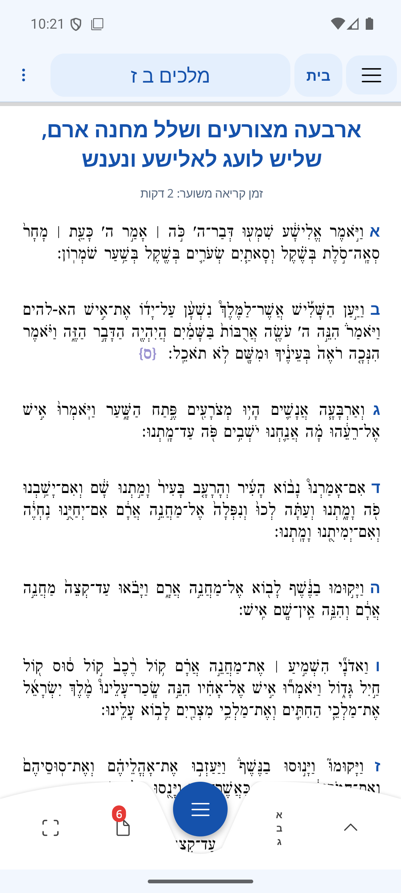
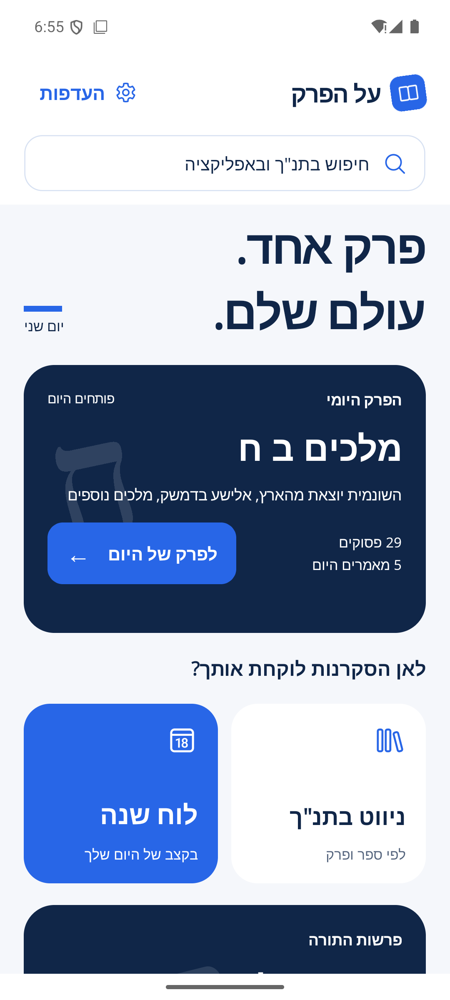
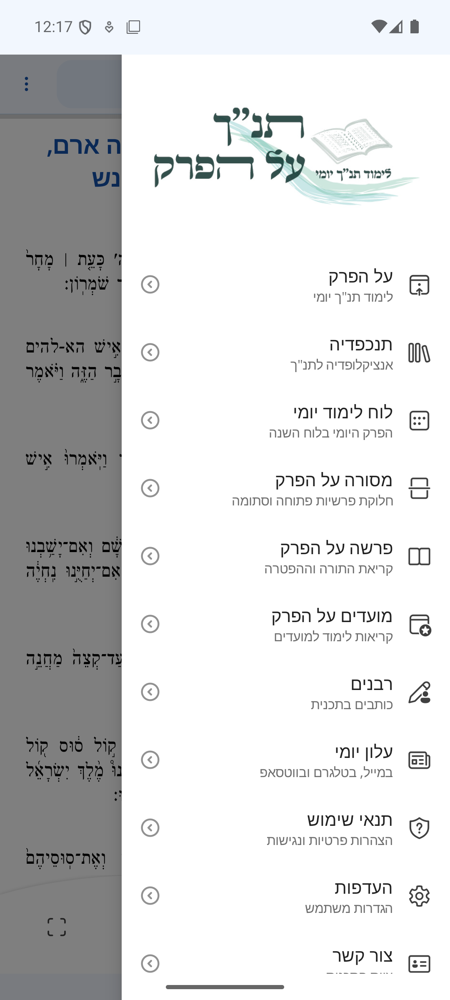
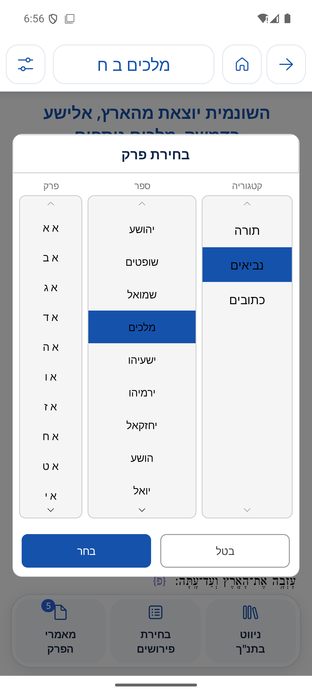
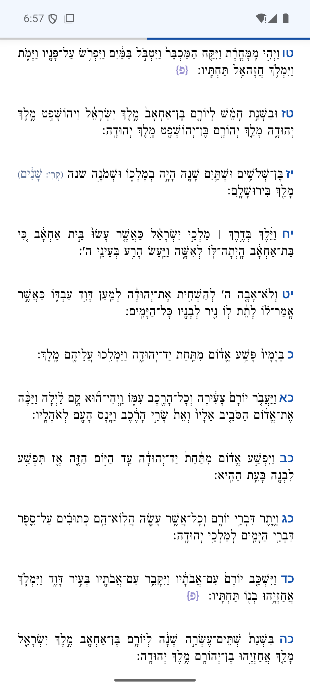
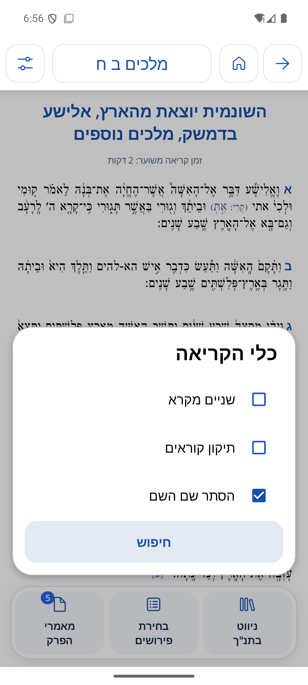
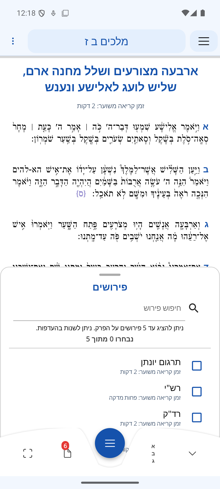
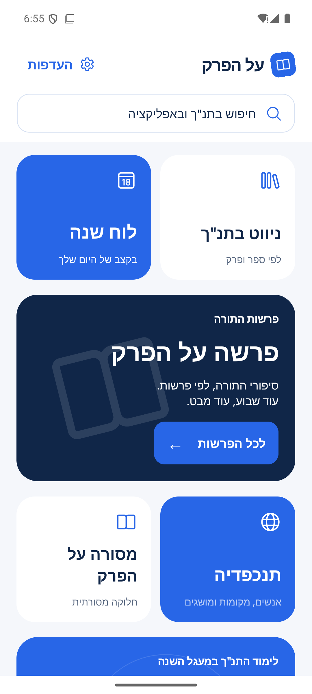
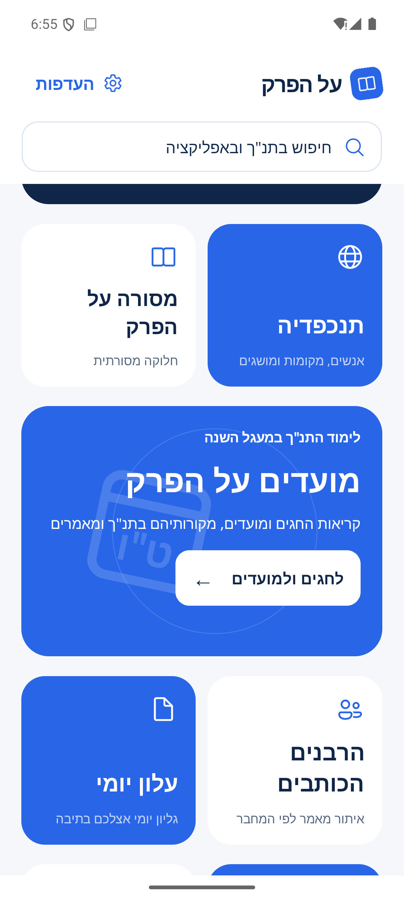
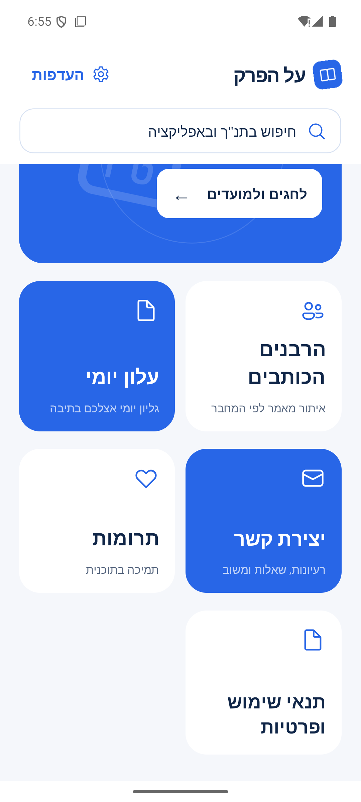

# על הפרק - לפני ואחרי מול הענף הראשי

ענף ביקורת מתמשך. ה-PR נשאר בטיוטה. אין למזג או להפעיל מיזוג אוטומטי בלי הוראה מפורשת מדורד.

[PR #3385](https://github.com/bible-on-site/bible-on-site/pull/3385) · [גלריית HTML בדפדפן](index.html) · [המסכים הנוכחיים](current.html)

כל צילומי ה"לפני" הם מהענף הראשי של המאגר, ולא מאיטרציות קודמות בענף ה-UX. מימין: המצב הקיים. משמאל: ההצעה הנוכחית. כל הצילומים והסרטונים נלקחו מהאפליקציה האמיתית באמולטור Android.

בסיס צילומי "לפני": `master / 95c202eb5`. עודכן: 2026-11-16.

הפרק היומי, הפרשות והמועדים מקבלים אריחים רחבים בבית. ביניהם אריחים בודדים. צילומי "אחרי" מתעדכנים באותם שמות קבצים.

GitHub מציג את ה-Markdown כתוכן מעוצב ותומך ב-rich diff ב-Files changed. ה-HTML נשמר כקוד ונפתח מקומית עם קובצי ה-CSS וה-assets.

## כניסה לאפליקציה - הפרק היומי במרכז

ב-master הכניסה היא ישירות לפסוקי הפרק. בהצעה החדשה נכנסים לבית עם כרטיס הפרק היומי הכהה, כותרת גדולה וכפתור כחול. כל יעדי הלימוד והקשר נמצאים בהמשך אותו דף.

<table dir="rtl">
<thead><tr><th align="right">לפני - הענף הראשי</th><th align="right">אחרי - הצעת UX</th></tr></thead>
<tbody><tr>
<td align="right"> הכניסה הקיימת: ישירות לקורא</td>
<td align="right"> הבית החדש עם כרטיס הפרק היומי</td>
</tr></tbody></table>

## מגלים עוד - בלי רשימת קישורים קטנים

הבית מערבב אריחים ברוחב מלא עם זוגות אריחים קטנים. הפרק היומי, הפרשות והמועדים מקבלים מקום מרכזי; יתר היעדים נפתחים ישירות מאריח בודד. זוגות האריחים מחליפים צדדים: לבן וכחול, ואז כחול ולבן אחרי הכרטיס הרחב.

<table dir="rtl">
<thead><tr><th align="right">לפני - הענף הראשי</th><th align="right">אחרי - הצעת UX</th></tr></thead>
<tbody><tr>
<td align="right"> מגירת הניווט ב-master</td>
<td align="right"> הכניסות בהמשך הבית</td>
</tr></tbody></table>

## ניווט, פירושים ומאמרי הפרק

ניווט בתנ"ך פותח בחירת ספר ופרק ונשאר קבוע גם במאמרים. בחירת פירושים קובעת מה יוצג לצד הפסוקים. מאמרי הפרק מתחלף לחזרה לפרק באותו מקום. מעטפת הסרגל לבנה, עם קווי מתאר דקים במקום שכבות של מילוי כחול.

<table dir="rtl">
<thead><tr><th align="right">לפני - הענף הראשי</th><th align="right">אחרי - הצעת UX</th></tr></thead>
<tbody><tr>
<td align="right"> הקורא ופס האייקונים הקיים</td>
<td align="right"> ניווט קבוע והחלפת פעולה באותו כפתור</td>
</tr></tbody></table>

## ניווט בתנ"ך מתוך הסרגל

אותו בורר ספר ופרק נפתח מכפתור ניווט בתנ"ך. הכפתור נשאר קבוע גם כשמוצגים מאמרי הפרק. גם כותרת בורר הפרק לבנה.

<table dir="rtl">
<thead><tr><th align="right">לפני - הענף הראשי</th><th align="right">אחרי - הצעת UX</th></tr></thead>
<tbody><tr>
<td align="right"> הניווט דרך כותרת הפרק ב-master</td>
<td align="right"> בחירת ספר ופרק מתוך הסרגל</td>
</tr></tbody></table>

## גלילה - אזור הקריאה נשאר יציב

בכניסה שני הסרגלים גלויים. כל גרירה משאירה אותם גלויים או מחזירה אותם מיד. אחרי סיום הגרירה ו-1.8 שניות ללא פעילות, העליון מחליק למעלה והתחתון דועך. אזור הקריאה שומר על גודל קבוע.

<table dir="rtl">
<thead><tr><th align="right">לפני - הענף הראשי</th><th align="right">אחרי - הצעת UX</th></tr></thead>
<tbody><tr>
<td align="right"> הקורא הקיים אחרי גלילה</td>
<td align="right"> הגלילה בהצעת ה-UX</td>
</tr></tbody></table>

## אפשרויות הקריאה - גיליון נוח ללחיצה

שניים מקרא, תיקון קוראים והסתרת שם השם מוצגים בגיליון בגודל התוכן. חיפוש פותח את החיפוש הקיים. אין כפתור מסך מלא: הסרגלים נעלמים אוטומטית אחרי גרירה והשהיה.

<table dir="rtl">
<thead><tr><th align="right">לפני - הענף הראשי</th><th align="right">אחרי - הצעת UX</th></tr></thead>
<tbody><tr>
<td align="right"> התפריט הקטן ב-master</td>
<td align="right"> גיליון האפשרויות החדש</td>
</tr></tbody></table>

## גודל הגופן ותצוגת הטקסט נמצאים בהעדפות

מסך העדפות התצוגה ממשיך לשנות את הגופן והתצוגה. הכפתור בסרגל הקורא הוחלף לניווט בתנ"ך. רקע הסרגל והכפתורים לבן.

<table dir="rtl">
<thead><tr><th align="right">לפני - הענף הראשי</th><th align="right">אחרי - הצעת UX</th></tr></thead>
<tbody><tr>
<td align="right"> העדפות התצוגה ב-master</td>
<td align="right"> העדפות התצוגה של האפליקציה</td>
</tr></tbody></table>

## חלונית הפירושים מכסה את הסרגל

החלונית נמצאת לפני הסרגל התחתון בציר Z, ומכסה אותו חזותית ובמגע. היא מתחילה בתחתית המסך, ללא רווח שמור לסרגל.

<table dir="rtl">
<thead><tr><th align="right">לפני - הענף הראשי</th><th align="right">אחרי - הצעת UX</th></tr></thead>
<tbody><tr>
<td align="right"> גיליון הפירושים הקיים</td>
<td align="right"> הפירושים מכסים את הסרגל התחתון</td>
</tr></tbody></table>

## מאמרי הפרק - תוכן נוסף עם דרך חזרה ברורה

במצב מאמרים, כפתור מאמרי הפרק עצמו מתחלף לחזרה לפרק. ניווט בתנ"ך נשאר באותו מקום וממשיך לפתוח את בורר הניווט.

<table dir="rtl">
<thead><tr><th align="right">לפני - הענף הראשי</th><th align="right">אחרי - הצעת UX</th></tr></thead>
<tbody><tr>
<td align="right"> מאמרי הפרק ב-master</td>
<td align="right"> חזרה לפרק באותו כפתור של מאמרי הפרק</td>
</tr></tbody></table>

## פרשה על הפרק - אריח רחב בבית

פרשות התורה מקבלות אריח ברוחב מלא, עם כותרת גדולה, ספר פתוח ברקע וכפתור כחול. מעליו ומתחתיו משולבים זוגות אריחים קטנים.

<table dir="rtl">
<thead><tr><th align="right">לפני - הענף הראשי</th><th align="right">אחרי - הצעת UX</th></tr></thead>
<tbody><tr>
<td align="right"> פרשות התורה דרך המגירה ב-master</td>
<td align="right"> אריח פרשות ברוחב מלא בתוך הבית</td>
</tr></tbody></table>

## לימוד התנ"ך במעגל השנה

אריח המועדים בכחול בהיר, עם קריאות החגים ומועדים, מקורותיהם בתנ"ך ומאמרים. האריחים בבית משלבים לבן ושני גווני כחול: כחול עמוק וכחול בהיר. סמל לוח השנה מציג ט"ו.

<table dir="rtl">
<thead><tr><th align="right">לפני - הענף הראשי</th><th align="right">אחרי - הצעת UX</th></tr></thead>
<tbody><tr>
<td align="right"> מועדים דרך המגירה ב-master</td>
<td align="right"> אריח מועדים רחב בין זוגות האריחים</td>
</tr></tbody></table>

## יצירת קשר ותרומות - קרוב לתוכן

הרבנים הכותבים מאפשר איתור מאמר לפי המחבר; העלון מציע גליון יומי אצלכם בתיבה. תרומות מוגדרות כתמיכה בתוכנית. תנאי שימוש ופרטיות מוצגים באריח קטן לצד יתר הכניסות.

<table dir="rtl">
<thead><tr><th align="right">לפני - הענף הראשי</th><th align="right">אחרי - הצעת UX</th></tr></thead>
<tbody><tr>
<td align="right"> קשר ותמיכה דרך המגירה ב-master</td>
<td align="right"> הניסוחים המעודכנים ואריח קטן לתנאי השימוש</td>
</tr></tbody></table>

## חיפוש בתוכן וגם ביעדי האפליקציה

זהו החיפוש הקיים של האפליקציה, עם אותם סינון, מיון ותוצאות. מסכים נמצאים בו כסוג תוצאה נוסף, ללא רשימת ניווט נפרדת. הכניסה מהבית ומכלי הקריאה מובילה לאותו רכיב חיפוש.

<table dir="rtl">
<thead><tr><th align="right">לפני - הענף הראשי</th><th align="right">אחרי - הצעת UX</th></tr></thead>
<tbody><tr>
<td align="right"> החיפוש בקורא הקיים</td>
<td align="right"> החיפוש הקיים כולל תוצאות מסוג מסך</td>
</tr></tbody></table>

## מה לחפש - גם מסך

מסך נוסף לבורר מה לחפש ומופיע ראשון כדי שיהיה קל לגלות אותו. אפשר לחפש למשל לוח שנה, העדפות או ניווט בתנ"ך באותה רשימת תוצאות שבה מחפשים פסוקים ומאמרים.

<table dir="rtl">
<thead><tr><th align="right">לפני - הענף הראשי</th><th align="right">אחרי - הצעת UX</th></tr></thead>
<tbody><tr>
<td align="right"> החיפוש ובורר מה לחפש ב-master</td>
<td align="right"> הסוג מסך בבורר הקיים</td>
</tr></tbody></table>

## לוח לימוד יומי - כחול על רקע קריר ובהיר

מעטפת בהירה וקרירה עם גובה ורדיוס אחידים לכותרת ולכפתורי הניווט. כפתורי הבית והחזרה גדולים ומופיעים באותם מקומות. רקע הסרגל והכפתורים לבן.

<table dir="rtl">
<thead><tr><th align="right">לפני - הענף הראשי</th><th align="right">אחרי - הצעת UX</th></tr></thead>
<tbody><tr>
<td align="right"> לוח השנה ב-master</td>
<td align="right"> לוח השנה עם המעטפת החדשה</td>
</tr></tbody></table>

## רבנים וכותבים - חזרה ובית באותה שפה

שדה החיפוש ממלא את כל הרוחב שנשאר לצד בית וחזרה. כפתור ניקוי מוסתר אינו שומר מקום ריק. רקעי הכותרת וכפתורי הסרגל בעלי גובה ורדיוס אחידים. רקע הסרגל והכפתורים לבן.

<table dir="rtl">
<thead><tr><th align="right">לפני - הענף הראשי</th><th align="right">אחרי - הצעת UX</th></tr></thead>
<tbody><tr>
<td align="right"> רבנים וכותבים ב-master</td>
<td align="right"> המסך בהצעת ה-UX</td>
</tr></tbody></table>

## העדפות - כניסה בולטת וחזרה צפויה

בבית יש כפתור העדפות גדול עם אייקון. בתוך ההגדרות נשמר אותו ניווט חזרה ובית, ללא תפריט צד מקביל. רקע הסרגל והכפתורים לבן.

<table dir="rtl">
<thead><tr><th align="right">לפני - הענף הראשי</th><th align="right">אחרי - הצעת UX</th></tr></thead>
<tbody><tr>
<td align="right"> העדפות ב-master</td>
<td align="right"> העדפות עם המעטפת החדשה</td>
</tr></tbody></table>

## גלילה בתנועה

[לפני - master](assets/before/reader-scroll.mp4) · [אחרי - הצעת UX](assets/after/reader-scroll.mp4)

הקלטות מסך אמיתיות. בהצעה החדשה יש הפסקות בין הגרירות כדי להדגים את ההשהיה, הדעיכה והחזרה.

## עדכון הביקורת

מעדכנים את צילומי `assets/after/` ואת התיאורים ב-`comparisons.json`, ואז מריצים `python generate.py`. צילומי ה-`before` חייבים להישאר מהענף הראשי, עם קומיט בסיס מתועד. לא מציבים צילום מאיטרציה קודמת של ענף ה-UX בעמודת "לפני".
