# על הפרק - ביקורת UX: לפני ואחרי

ענף ביקורת מתמשך. ה-PR נשאר בטיוטה. אין למזג או להפעיל מיזוג אוטומטי בלי הוראה מפורשת מדורד.

[PR #3385](https://github.com/bible-on-site/bible-on-site/pull/3385) · [דף HTML להשוואה בדפדפן](index.html)

כל התמונות והסרטונים הם צילומים אמיתיים מהאפליקציה באמולטור Android. צילומי ה"לפני" נשמרים כבסיס קבוע; קובצי ה"אחרי" מתעדכנים בשמות קבועים בכל סבב, כדי ש-GitHub יציג גם את השינוי בתמונות בין הקומיטים.

ב-GitHub אפשר לפתוח את ה-Markdown בתצוגה מעוצבת, ולבחור rich diff ב-Files changed. [תיעוד GitHub](https://docs.github.com/en/repositories/working-with-files/using-files/working-with-non-code-files). ה-HTML עצמו נשמר כקוד; לתצוגה שלו פותחים מקומית את index.html עם תיקיית assets.

עודכן: 15 בנובמבר 2026. סבב 02. הבסיס לצילומי "לפני": `ee7e5f952`.

## בית - לשמור את הכיוון, לשפר את הלחיצה

העיצוב של הבית נשמר. כפתור ההעדפות מקבל משטח ברור, אייקון ושטח לחיצה גדול; החיפוש נשאר קבוע מעל התוכן.

| לפני | אחרי |
| --- | --- |
| 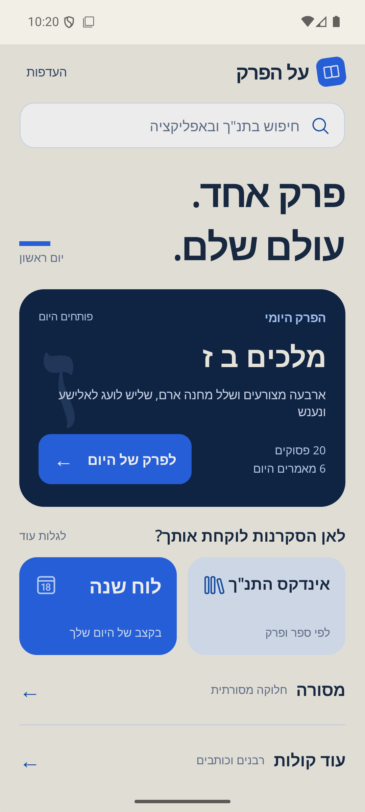 |  |

## ניווט בבית - פחות אפשרויות בבת אחת

קישורי הטקסט הקטנים בתחתית הוחלפו בכניסה אחת לספרייה. מסורה והרבנים מוצגים כשורות נוחות ללחיצה, עם תיאור מתחת לכותרת.

| לפני | אחרי |
| --- | --- |
| 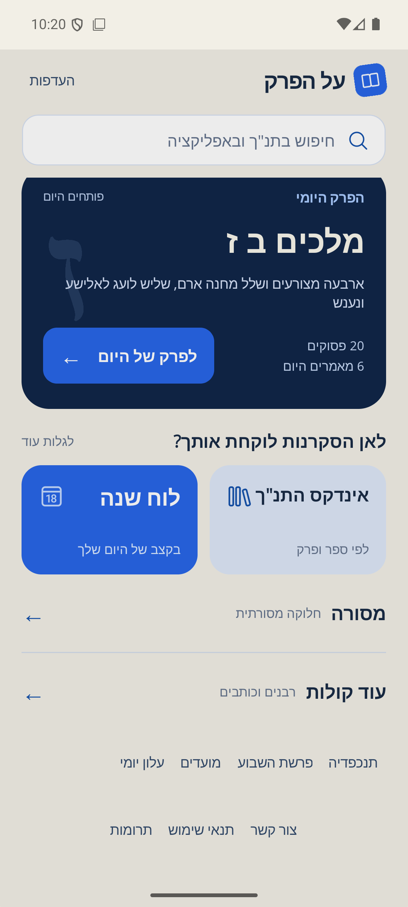 |  |

## קריאה - מעטפת אחת

התפריט הצדדי והמניפה הוסרו מהסקיצה. למעלה יש חזרה, בית ובחירת פרק; למטה פס פעולות אחד: קריאה, פירושים ומאמרים.

| לפני | אחרי |
| --- | --- |
|  | 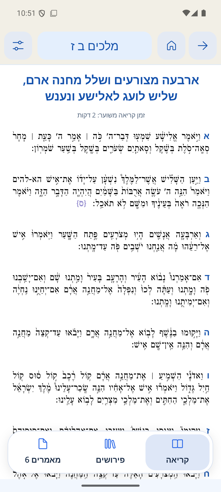 |

## גלילה - הטקסט נשאר יציב

אזור הקריאה שומר על גודל קבוע. הכותרת נעה מעליו, לפי תנועת האצבע, בלי לשנות את גודל הרשימה ובלי לקבל משוב חוזר מהפריסה.

| לפני | אחרי |
| --- | --- |
| 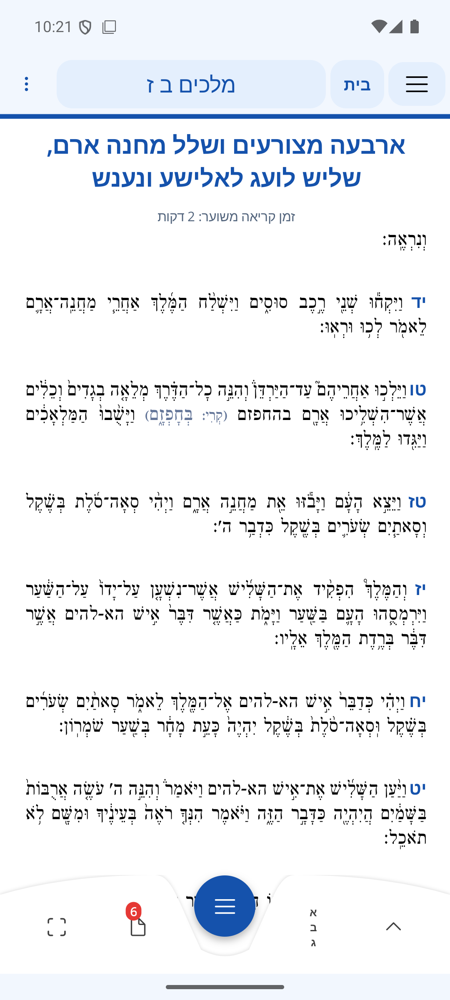 |  |

## כלי קריאה - במקום תפריט צפוף

אפשרויות הקריאה מרוכזות בגיליון רחב עם שורות וכפתורים גדולים. הגיליון כולל חיפוש, תצוגה ומסך מלא.

| לפני | אחרי |
| --- | --- |
| 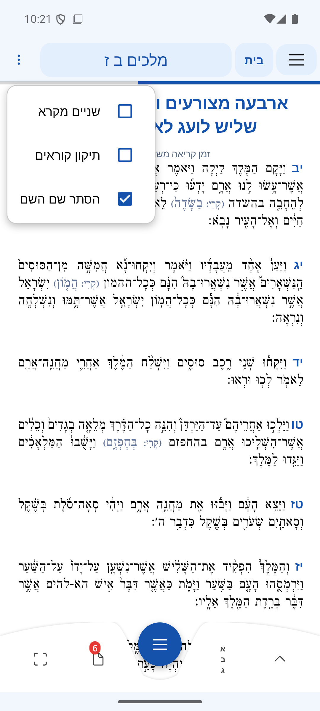 |  |

## מאמרים - אותו קורא, אותה דרך חזרה

המעבר למאמרים שומר את מסגרת הניווט ואת פס הפעולות החדש. אפשר לחזור לקריאה בלי לפתוח תפריט נוסף.

| לפני | אחרי |
| --- | --- |
| 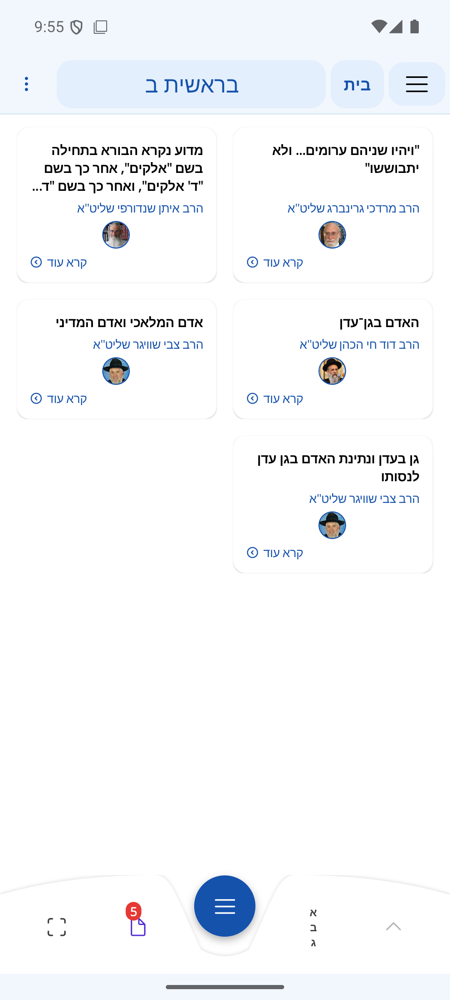 | 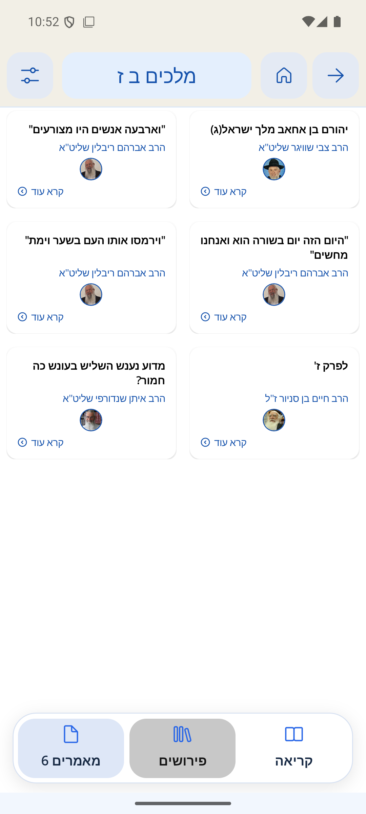 |

## הספרייה - בית ברור לתכנים הנוספים

קודם האפשרויות היו מפוזרות בתחתית הבית. כעת תנכפדיה, פרשת השבוע, מועדים ועלון יומי מקבלים עמוד עם כרטיסים גדולים. מידע ועזרה נמצאים ברמה נפרדת.

| לפני | אחרי |
| --- | --- |
|  |  |

## חיפוש - שדה וכפתורים שנוח ללחוץ

שדה החיפוש מקבל משטח ברור. כפתורי החזרה והניקוי גדולים ומובחנים, וברירת המחדל מציגה ארבעה קיצורי דרך בלבד. חיפוש עדיין מוצא גם מסכים וגם תוכן.

| לפני | אחרי |
| --- | --- |
| 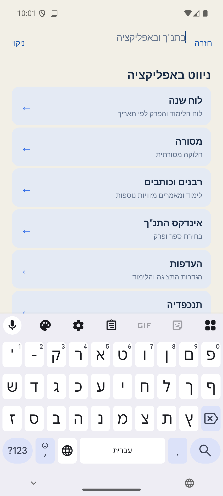 |  |

## לוח שנה - ניווט משותף

גם במסך קיים יש כעת חזרה ובית באותם מקומות ובאותם גדלים. תפריט הניווט הישן אינו נפתח משם.

| לפני | אחרי |
| --- | --- |
| 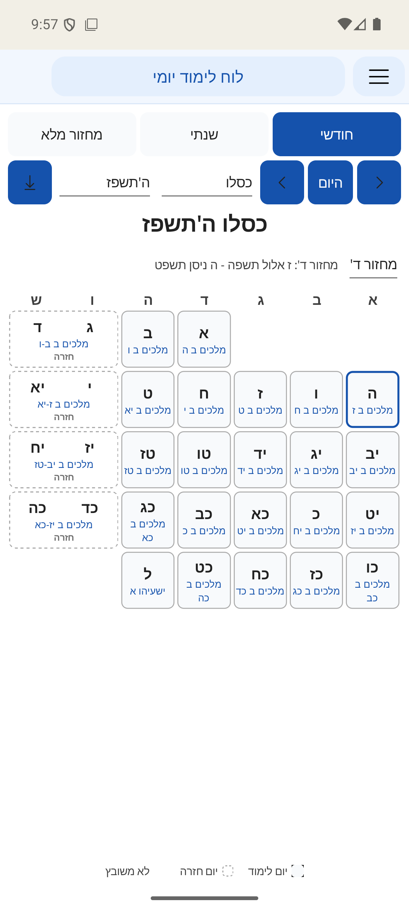 | 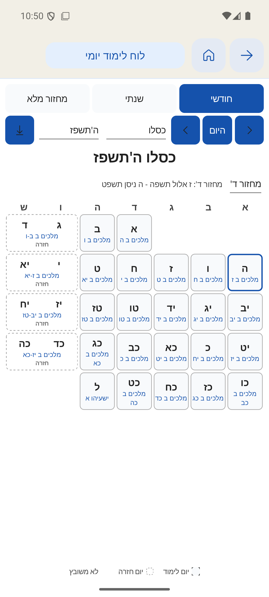 |

## רבנים וכותבים - אותה מעטפת

רשימת הכותבים מקבלת את אותו ניווט חזרה ובית. אין מסלול ניווט מקביל דרך תפריט צד.

| לפני | אחרי |
| --- | --- |
|  | 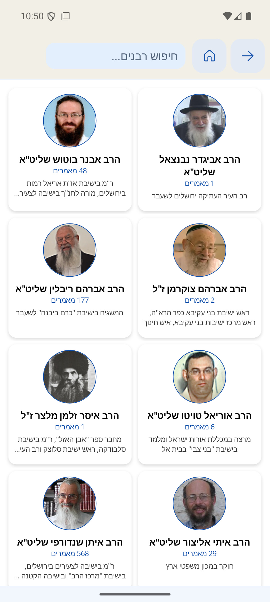 |

## העדפות - כניסה ברורה, חזרה צפויה

הכניסה מהבית היא כפתור גדול, ובתוך ההעדפות נשמר אותו מבנה ניווט. ההגדרות עצמן ממשיכות להשתמש במסכים האמיתיים של האפליקציה.

| לפני | אחרי |
| --- | --- |
| 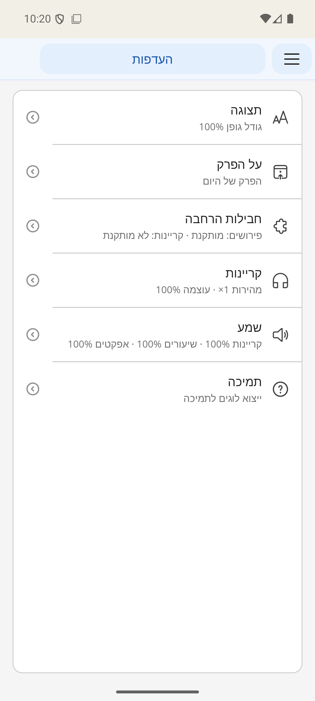 |  |

## אותן מחוות, לפני ואחרי

גלילה רציפה באמולטור, כולל שינויי כיוון ותנועה קצרה כלפי תחילת הפרק. הסרטונים הם הקלטות מסך, לא אנימציה של העיצוב.

[וידאו לפני](assets/before/reader-scroll.mp4) · [וידאו אחרי](assets/after/reader-scroll.mp4)

## מה לבדוק בסבב הזה

- האם הדרך מהבית לקריאה, לספרייה ולחזרה ברורה?
- האם כפתורי ההעדפות והניווט נוחים ללחיצה?
- האם הכותרת מסתתרת וחוזרת בלי קפיצות או הבהובים?
- האם מעבר למאמרים ולמסך מלא שומר על אותה מעטפת?
- מה עדיין דורש עיצוב נוסף במסכים המשניים?

## עדכון הסבב הבא

1. משאירים את צילומי הבסיס תחת `assets/before/`.
2. מצלמים שוב את אותם המצבים באמולטור ומעדכנים את הקבצים התואמים תחת `assets/after/`.
3. מעדכנים את הסעיפים הרלוונטיים ב-HTML וב-Markdown ואת יומן הסבבים.
4. דוחפים לענף הביקורת ומשאירים את ה-PR בטיוטה. אין מיזוג בלי הוראה מפורשת.
