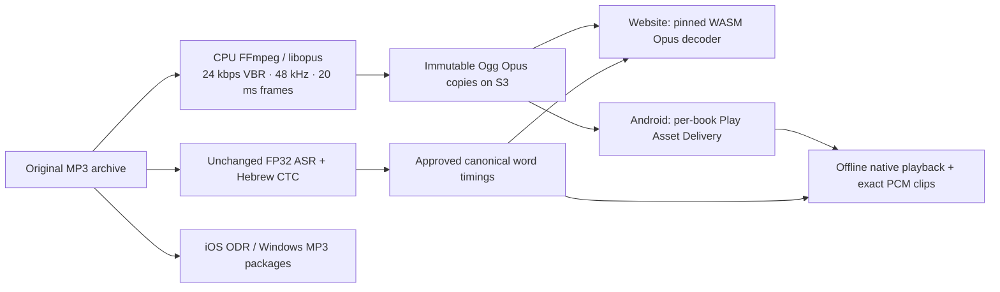

# Playback compression

The alignment worker always reads the original `*_record.mp3` recordings. Its models, precision, beam search, caches, source hashes and canonical word timings do not depend on playback compression.



`playback.py` converts at most two recordings concurrently, using CPU encoders with one thread each. It never trims silence, normalizes volume, changes playback speed, writes to the source directory or opens the worker checkpoint. It checks the original MP3 hash before and after conversion, and requires an identical decoded frame count at 48 kHz. Ogg pre-skip and end trimming preserve the recording time origin.

```powershell
python data/recitation/playback.py C:/Users/Dorad/git/tanah-s3/recordings
aws s3 sync .cache/recitation-opus s3://bible-on-site-assets/recordings/opus-24k/ --exclude '*' --include '*.ogg' --exclude '*.download.ogg' --content-type audio/ogg --cache-control 'public,max-age=31536000,immutable'
```

Before committing the generated inventory, verify every uploaded asset's full SHA-256, MIME type, CORS and byte-range response. The inventory is `web/bible-on-site/src/data/recitation/opus-playback.json`; each entry binds the original source hash to a separate playback hash. S3 names use playback hashes. A changed MP3 cannot silently use an old derivative. Native CI fetches those exact bytes and packages them without re-encoding; native runtime never downloads from S3.

Android's bundled catalog keeps the original `audioSha256`, URL, duration, words and approved intervals, with a separate `playback` descriptor. The book archive and installed file are verified against the compressed hash. Old MP3 installations remain valid only for releases whose catalog selects MP3; a new Opus catalog prompts installation of the current book pack. Once replacement audio is verified, obsolete MP3 copies in the app download directory are removed; files still referenced by the catalog or a failed upgrade are preserved.

The website and Android clip bridge use locked `ogg-opus-decoder` 1.7.5 / `opus-decoder` 0.7.12. Complete-file decoding applies pre-skip and final-page trimming before selecting the original millisecond ranges. No ML speech enhancement is enabled. The committed two-second fixture checks sample count, sample origin and exact clips against FFmpeg's libopus PCM reference, and the existing MP3 tests remain.

Opus at 24 kbps is lossy playback compression, not a replacement for archival MP3s. The pipeline remains unchanged. Native iOS Ogg support is intentionally deferred to [Devin follow-up #2105](https://github.com/bible-on-site/bible-on-site/issues/2105); iOS and Windows packages retain MP3 in this delivery.
