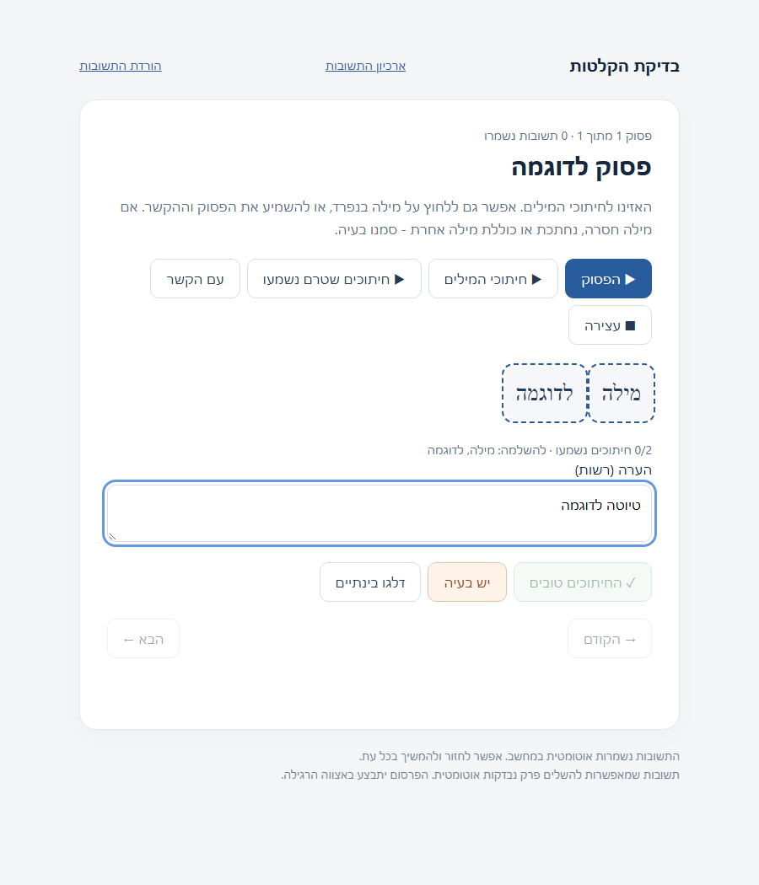
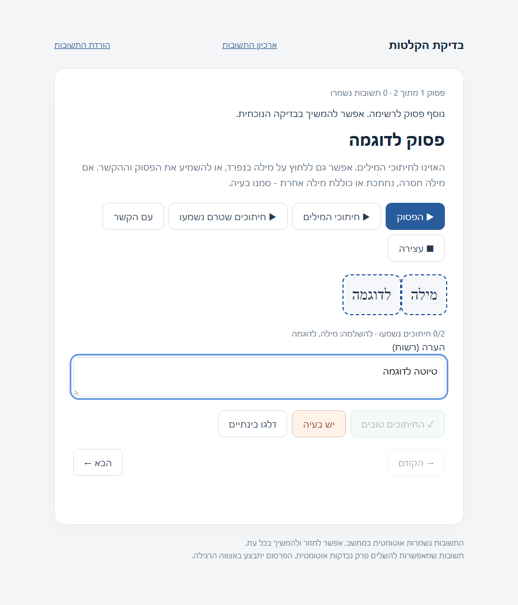

# Accumulated review queue evidence

Real headless Chromium captures of the application HTML against a read-only
synthetic fixture. No actual recording, review, session secret or user draft is included.

Before: one passage; the page does not discover later batches.

After: a second passage arrives automatically. The same passage and unsaved note
remain on screen. A later browser reload also restores the note.

The fixture has no review-writing route. Browser regressions additionally verify
that completed hearing is preserved only for the exact candidate/clip, and an
interrupted cut is never counted as heard.
