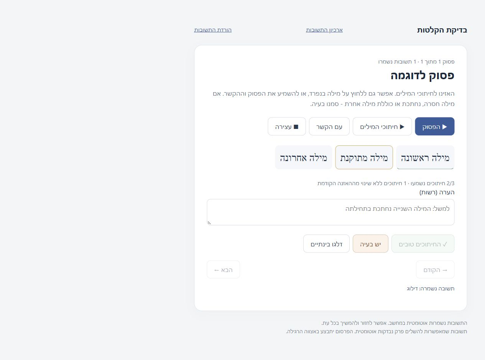
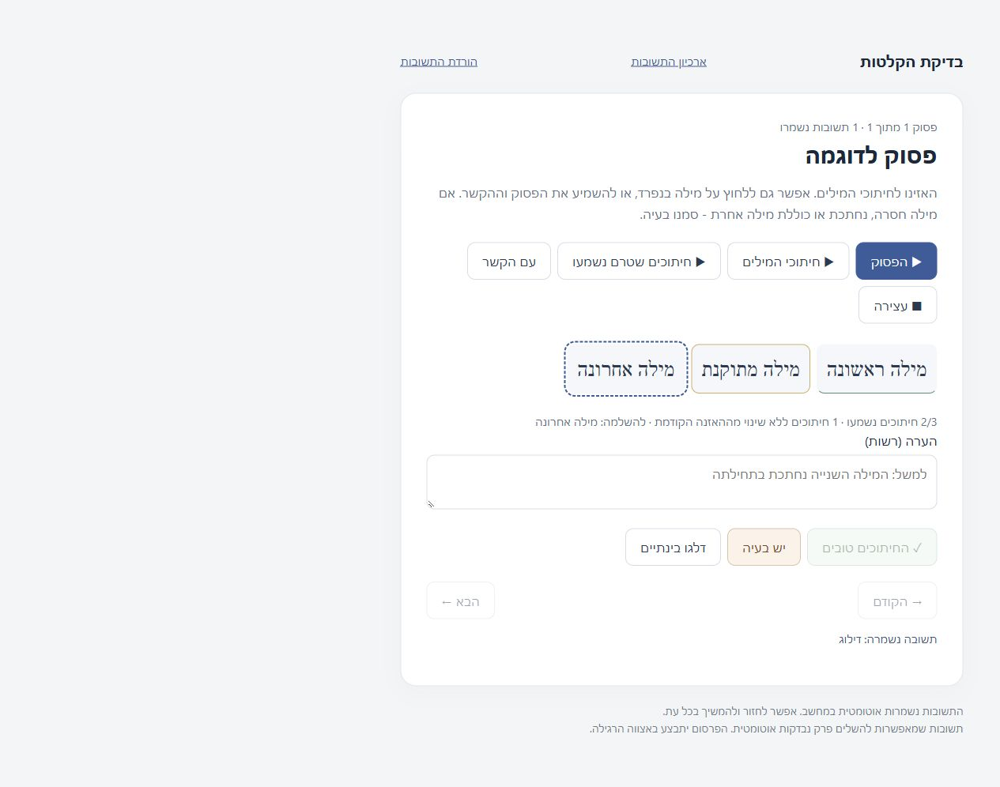

# Listening UI regression evidence

These captures use only synthetic words and fixture playback state. They contain no real queue, recording, review, note, username, session, or local path. The loopback fixture has no review-writing route.

Before: the last unchanged word is not heard but has no indication; GOOD is disabled.

After: the missing word is named and outlined, with a button to play only unplayed cuts. GOOD stays disabled until playback finishes.

