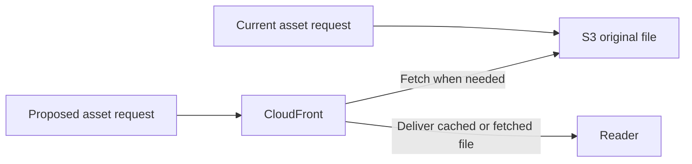

# CloudFront research and PR #2676 review - 2026-10-27

Observed October 27 UTC; documented October 28. This is a dated, read-only
inspection of account `250598594267`, primarily `il-central-1`, using the existing
`AdministratorAccess-250598594267` profile. No AWS configuration, database content,
DNS, services or bucket access was changed. These observations are not a current
inventory guarantee or approval for a rollout.

## Assessment

Keep [#2508](https://github.com/bible-on-site/bible-on-site/issues/2508) as a
bounded experiment. Evidence does not yet justify routing the whole website
through CloudFront. A no-cache edge can improve network delivery and connection
reuse, especially for remote viewers, but still needs nginx and the application
for origin fetches. It cannot remove application work or protect against an
unavailable single origin. No distribution existed during inspection, so no
CloudFront speed improvement was measured.

Prioritize identifying the S3 transfer source and evaluating the separate,
additive asset CDN in [#2576](https://github.com/bible-on-site/bible-on-site/issues/2576).
The observed S3 internet-transfer bill is substantially larger than EC2's.
Preserve legacy public S3 URLs and validate mutable keys, audio ranges, CORS and
browser freshness before changing asset delivery. See the compatibility rules in
[the previous audit](cost-risk-audit-2026-10-23.md).

## Live routing and resource findings

- CloudFront: zero distributions.
- Both public apex A records point to the existing nginx EIP, `51.85.17.212`,
  TTL 300. `www` and wildcard `*` CNAMEs point to their respective apex.
- Neither public zone has an explicit `api`, `admin` or `origin` record. Public
  DNS queries independently confirmed that all these names follow the apex.
  The inspected Route 53 NS records match active public delegation in both zones.
- **Cutover blocker:** moving an apex also moves its wildcard API/admin routes.
  Explicit direct-origin records in both zones are a prerequisite, not a
  guarantee supplied by the current configuration. An `origin.` name resolving
  through the wildcard is likewise not independent of the apex.
- The sole nginx EC2 remains `t3.small`. Website and API each have one running
  on-demand Fargate task; admin has one Spot task. The website allocates
  0.25 vCPU and 2 GiB. No pending tasks were observed.
- Effective nginx configuration already has `gzip on`. This does not prove all
  content types are compressed; check response encodings instead of assuming
  compression is absent.
- nginx has no trusted real-IP configuration. Crawler per-IP limits and
  `X-Real-IP` use `$remote_addr`. Behind CloudFront this becomes a shared proxy
  address, potentially grouping unrelated crawlers. Configure trust specifically
  for the approved proxy path; the direct origin must not trust arbitrary
  client-supplied forwarded-IP headers.
- The candidate `cloudfront.net` hostname is publicly reachable and crawlable.
  No alias avoids a production DNS change; it does not provide private access.
  Approve access/indexing controls and teardown before creating the candidate.

## Load and existing timing evidence

Window: October 20 00:00 through October 27 00:00 UTC, seven complete days.
CloudWatch aggregates include 168 hourly periods. Maximum values below refer to
reported metric samples, not instantaneous peaks.

| Observation | Result | Interpretation and limit |
| --- | --- | --- |
| Router CPU | 0.396% average; maximum reported sample 3.239% | Little CPU pressure in this window; not a proof about TLS jitter or all connection limits |
| Router CPU credit balance | Minimum 576, unchanged | No observed credit exhaustion |
| Website CPU | 17.845% average; maximum sample 100% | Bursts reached the task allocation; duration and cause are not established |
| Website memory | 47.855% average; maximum sample 69.580% | Does not establish the cause of slow requests |
| Website running-task metric | Minimum 1 in every hourly period | A single origin task remains a dependency; not an end-to-end availability measurement |
| nginx access requests | 1,180,164 | All logged virtual hosts/schemes, including bots and rejected requests; not visitor count |
| Bot-like user agents | 590,222, about 50% | Classification by declared user agent, not verified bot or human identity |
| HTTP 429 responses | 101,578, about 8.61% | Existing crawler controls already reject substantial traffic |
| Response body bytes in access logs | 19,334,347,049 | Excludes protocol overhead and does not equal billed transfer |
| `/_next/static/` response bytes | 535,523,400, about 2.8% of logged body bytes | Caching these files alone addresses a small part of measured router bytes; S3 delivery is separate |
| `/api/health` timing | 30,307 records; server p99 1,684 ms; upstream p99 1,684 ms | Evidence of an upstream latency tail, not browser page-load or external TLS latency |
| `/api/recitation/<id>` timing | 13,595 records; server p99 1,936 ms; upstream p99 1,904 ms | Also contains upstream delay; separate percentiles cannot be subtracted to compute exact proxy overhead |

The existing combined access log lacks the host and general request timing, so
it cannot provide per-domain or real-user page-load percentiles. Timing comes
from the existing `release-probes.log` for its selected health/recitation paths.
The read returned aggregate counts only, without publishing visitor IPs, cookies,
raw user-agent strings or request queries.

## Billed usage and opportunity

Cost Explorer unblended usage in USD, excluding tax. October figures remain
estimated; no credit/refund rows appeared in the inspected periods. Dates are
complete UTC days with an exclusive October 27 end.

| Internet transfer | October 1-26 | October 20-26 |
| --- | --- | --- |
| EC2 | 43.98 GB / $3.77 | 20.50 GB / $2.26 |
| S3 | 462.51 GB / $43.56 | 163.13 GB / $17.94 |

No CloudFront billing rows appeared. At the seven-day rate, those transfer
charges project to roughly $10 and $77 per 30 days respectively. These are
projections of existing spend, not CDN savings quotes. Traffic is changing:
October 26 alone had 52.79 GB of S3 transfer, up from 27.25 GB on October 25.

Only `bible-on-site-assets` and `bible-on-site-data-deploy` were listed, both in
Israel. Resource-level Cost Explorer attribution was not enabled, and the asset
bucket had no server-access logging or request-metric configurations. Therefore
the S3 bill cannot conclusively be assigned to a bucket, object family or caller.
Do not present all S3 spend as proven recording/image traffic or avoidable cost.
No new monitoring or billing features were enabled to fill this gap.

[CloudFront pay-as-you-go pricing](https://aws.amazon.com/cloudfront/pricing/pay-as-you-go/)
includes 1 TB of internet transfer and 10 million HTTP(S) requests per month,
and AWS-origin fetch transfer is free. This differs from the separate
[flat-rate plans](https://aws.amazon.com/cloudfront/pricing/).
At recent rates an experiment could have little delivery cost, but allowances,
growth, optional features and continued use of old S3 links affect actual savings.
Moving S3 traffic can also free some of the shared regional
[100 GB internet-transfer allowance](https://aws.amazon.com/about-aws/global-infrastructure/global-network/faqs/)
for remaining direct traffic. None of this removes fixed EC2/ECS/DB/VPC costs.

## S3 storage and CDN delivery

S3 stores the original images, audio and other objects. CloudFront is a CDN
that can deliver those same files from locations nearer the reader. S3 remains
the source; CloudFront fetches it when required and can reuse a safe cached copy.

The asset proposal changes delivery of files. The separate website-edge proposal
places CloudFront in front of nginx and Next.js pages. Page delivery has extra
redirect, authentication, RSC/navigation, query and publishing-invalidation
requirements. A low-risk asset candidate is additive: old S3 links continue to
work, new CDN links are adopted gradually, and an in-use CDN is never removed
while published URLs depend on it. Caching requires a proven policy for each
key family; an object being in S3 does not make it immutable.

## Review corrections to PR #2676

The original reviewed head was `0f261bb08d4a544335364138d9b9e50aae211d66`.
Its 40 existing tests passed, but did not exercise these regressions. The
follow-up source changes correct the following; no live distribution has been
created or validated by those tests.

| Finding | Correction |
| --- | --- |
| Wrong managed origin-request policy UUID prevented creation | Use AWS's `AllViewerExceptHostHeader` ID, `b689b0a8-53d0-40ab-baf2-68738e2966ac` |
| Explicit `TLSv1.3` is not a valid `OriginSSLProtocols` API enum | Use `[TLSv1.2]`; newer TLS negotiation is automatic where supported |
| Canonical comparison discarded scheme/host | Compare full canonical URLs resolved against their actual request URLs |
| Redirect comparison missed HTTPS-to-HTTP drift | Compare redirect origins, including scheme and port |
| Cached error could pass the `X-Cache` substring check | Capture/report `Age`, reject its presence including zero, and accept an uncached error without it |
| Latency script could not target the candidate | Add `--origin` for equivalent website-only cases, preserve the default production matrix and record actual connection reuse |
| API/admin isolation and absent gzip were assumed | Correct the rollout plan using live DNS and effective nginx configuration |
| Index claimed a log bucket absent from the template | Document the actual no-access-log candidate and the limits of origin logs |

AWS primary references: [managed policy ID](https://docs.aws.amazon.com/AmazonCloudFront/latest/DeveloperGuide/using-managed-origin-request-policies.html#managed-origin-request-policy-all-viewer-except-host-header),
[origin protocol enum](https://docs.aws.amazon.com/cloudfront/latest/APIReference/API_OriginSslProtocols.html),
[automatic TLS 1.3 origin support](https://aws.amazon.com/about-aws/whats-new/2025/11/amazon-cloudfront-tls13-origin/),
[cached errors and Age](https://repost.aws/knowledge-center/cloudfront-custom-object-caching).
`CachingDisabled` itself also disables error caching according to
[AWS's error-response documentation](https://docs.aws.amazon.com/AmazonCloudFront/latest/DeveloperGuide/HTTPStatusCodes.html);
missing error-TTL overrides were not a defect in this template.

## Evidence sources and remaining gates

Reads used STS identity verification; Route 53 record/delegation and public DNS
queries; CloudFront inventory; EC2/ECS descriptions; CloudWatch EC2/ECS metrics;
Cost Explorer service/usage/record-type queries; S3 inventory and logging/metric
configuration; and SSH read-only aggregation of the live Ubuntu nginx config,
rotated access logs and release-probe logs. No passwords or decrypted SSM values
were retrieved. Recheck the target account and current state before any change.

Follow [the revised rollout plan](edge-rollout-validation.md) for explicit
API/admin and wildcard isolation, trusted viewer IPs, origin retargeting, each
public alias, browser authentication, candidate access/indexing controls,
representative Israeli/overseas measurements, freshness and rollback gates.
Every live step and the current AWS-related PR still need Dorad's specific
approval. Green CI and this research are not merge or deployment approval.
