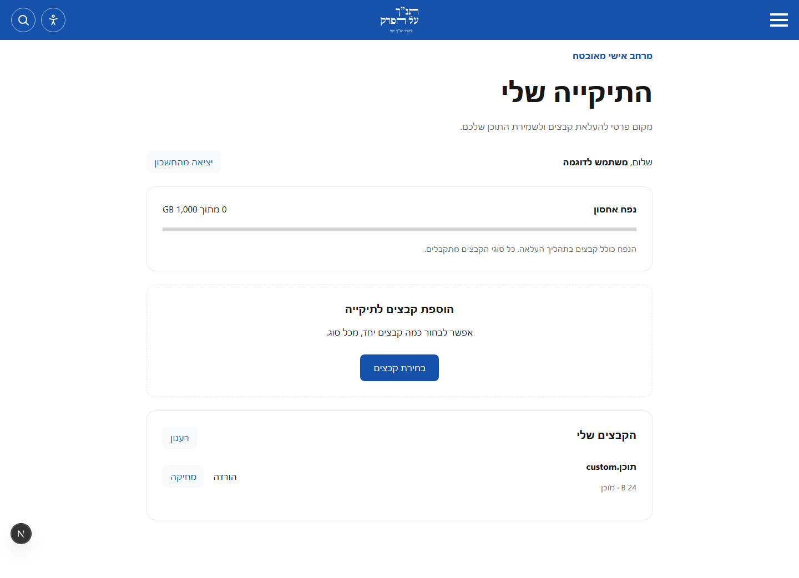
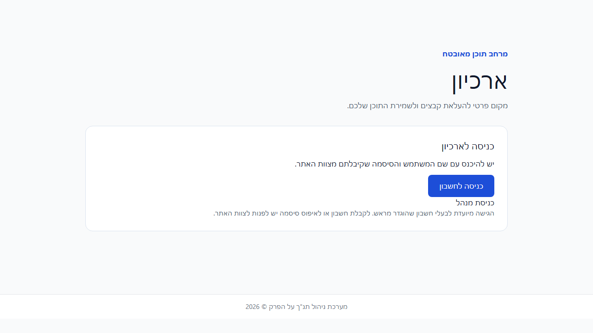
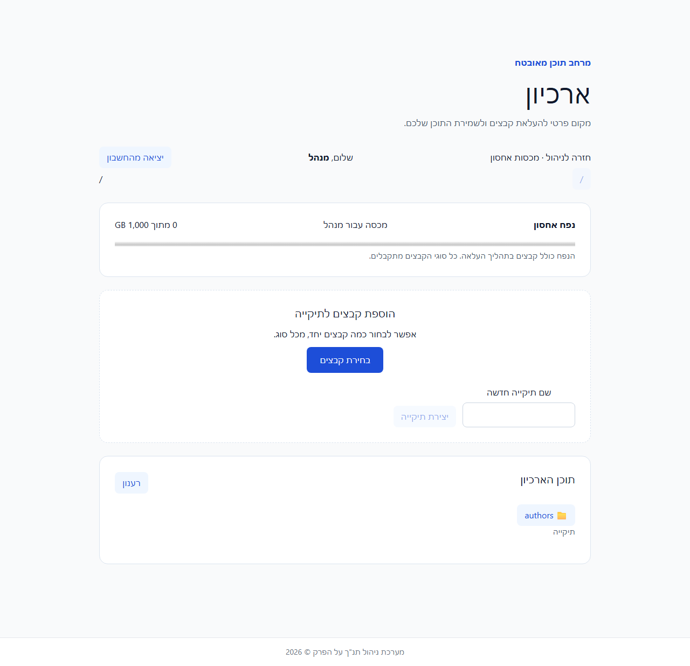
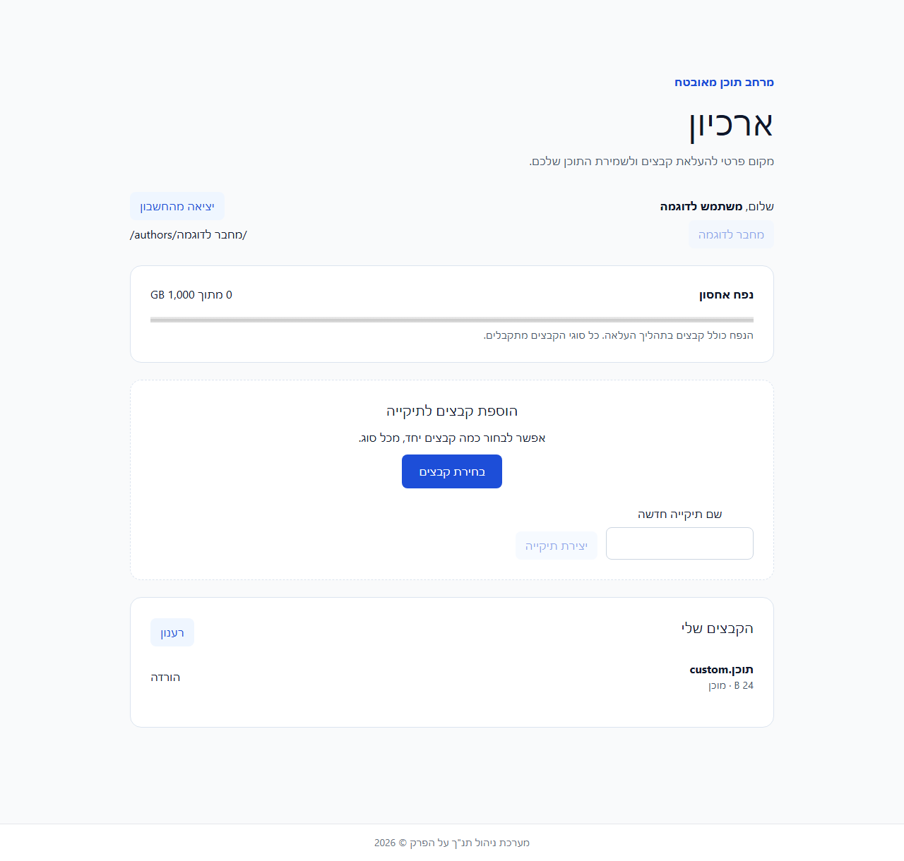
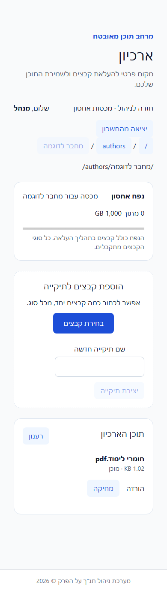

# Private admin archive

The archive belongs entirely to **web/admin**, at
`https://admin.xn--febl3a.co.il/archive`. The customer website has no archive
routes, login code, dependencies, navigation or storage permissions.

| Verified role | Application access | Filesystem access | Completed-file deletion |
| --- | --- | --- | --- |
| `admin` | Entire existing admin app, archive and `/archive-settings` | Root `/`, all folders and all author homes | Allowed |
| `archiver` | Archive shell and authenticated archive API only | Own `/authors/<author name>/` and descendants | Denied |

Existing admin SSO and scoped machine credentials retain their permissions.
Pre-created native Cognito accounts always receive `archiver`, even if their
username or custom claims say “admin”. Their tokens are never trusted by the
existing admin SSO verifier. The global server entry denies their access to
other admin pages and server functions. Hiding navigation is supplementary.
A public archive login shell contains no account or directory data.

## Identities and directories

A separate Cognito pool allows administrator-created accounts only. There is no
AWS registration, IAM user or browser AWS credential. We supply a username and
temporary password; Cognito requires a new password at first login. Account
creation, disablement and password resets remain in Cognito. Disable invitations
when creating an account whose credentials will be delivered manually.
Set the required `name` attribute to the intended author name before first use.

Cognito `sub` binds directory ownership permanently. A named home such as
`/authors/הרב מחבר לדוגמה/` uses that name in its S3 keys. Duplicate names receive
an immutable ID suffix; changing a profile name does not move an existing home.
Deleting and recreating an account never grants it another account's home.
Admins synchronize pre-created named homes when opening `authors`, so authors
need not log in before receiving content. No user-management application is added.

Root is the bucket's logical `/`. An administrator can create general folders
there. Author files use `authors/<name>/<nested folders>/<filename>`.
The URL mirrors the displayed directory, for example
`/archive/authors/<name>`. Every path, directory ID, file ID, part and completion
request is checked against the verified actor. Author breadcrumbs stop at home.
Folders and files share one name namespace. Folder names reject traversal,
control characters and invalid Unicode; S3 keys are limited to 1024 UTF-8 bytes.

## Database connection verification

Both admin database pools verify the server certificate and hostname, using the
[official RDS root bundle](https://docs.aws.amazon.com/AmazonRDS/latest/UserGuide/UsingWithRDS.SSL.html)
for `il-central-1`, bundled as public certificate data. The roots were retrieved
on 2026-11-11 and a real TLS 1.3 handshake to the current RDS endpoint passed
certificate and hostname validation without sending database credentials.
The task-owned temporary test ingress was removed and its absence verified.
Plaintext is permitted only for non-production loopback development databases.

## Storage and quotas

Only the **admin ECS task role** can read or write data in the new private S3
bucket. A bucket policy explicitly denies all other data principals, including
the customer website role, end users, anonymous requests and AWS console SSO
administrators. Public access is blocked, ACLs disabled, TLS required and server
side AES256 encryption enabled. Recovering data as an operator requires an
explicit reviewed bucket-policy change.

Files of any type are proxied through the admin service. Browsers receive no
bucket URLs, presigned URLs, multipart IDs or AWS credentials. Downloads are
binary attachments with `nosniff` and a sandbox CSP. Uploaded HTML is never
served as an executable page.

Default quota is **1000 decimal GB = 1 TB**. `/archive-settings` lets admins
change the global default or individual overrides. Pending files reserve their
full size. An admin uploading into an author's home consumes that author's
quota. Concurrent quota edits and reservations use InnoDB locks across replicas.
Lowering a quota preserves existing files and blocks additional storage until
usage fits. The allowance does not preallocate storage.

Multipart chunks stream without holding a database connection. Metadata
transitions use a separate bounded pool of three connections. Reservations are
committed before any S3 write. Authors can cancel incomplete uploads, but cannot
delete ready files or retry a marked deletion. Admins can delete completed files
and retry cleanup. Deletion intent is durable before S3 data removal; failed
cleanup keeps the reservation. S3 aborts abandoned multipart uploads after seven
days, while metadata remains visible for deliberate cancellation. Individual
files can reach 5 TB when quota permits. Listings are bounded to 100 entries,
with indexed timestamp/ID pagination.

Native login uses authorization code with PKCE and a short-lived state cookie.
Access and refresh tokens are HttpOnly, SameSite=Lax and Secure in production.
Cookies use Path=/ so the admin boundary can reject an archiver visiting other
admin routes. That cookie grants no admin permissions. Refresh is bounded to one
day and Cognito checks account revocation/disablement for every archive API call.
Mutations require the configured Origin. Archive pages and API responses use
no-store and noindex/nofollow/noarchive. No public sitemap includes the archive.

## Reviewed rollout

**Dorad must explicitly approve this PR's current AWS changes before merge or
live activation. The earlier website-upload approval does not cover this revised
admin-only architecture.**

1. Verify account `250598594267`, region `il-central-1`, the live admin task role
   `adminTaskRole` and its exact ARN. Save current task definitions, pinned image
   digests and the current router file. Recheck them immediately before applying.
2. Deploy only `devops/aws/private-archive.yaml`, passing
   `AdminTaskRoleArn`, `AdminTaskRoleName` and the canonical `AdminOrigin`.
   This new deployable artifact is outside the reference-only templates in
   `docs/aws/cloudformation/`. It adds a retained private bucket, retained native user pool, public PKCE
   client/domain and S3 plus pool-scoped ListUsers permissions on the admin role.
   It does not change the existing admin SSO pool/client or website role.
3. Apply `node devops/private-archive-db.mts` with DB_URL supplied securely.
   Run twice to confirm idempotence. The schema upgrade preserves older test
   metadata and keys within the same configured bucket. This is the first live
   private-archive deployment: neither an older upload bucket nor an author pool
   exists in the target account. This migration does not copy objects between
   buckets or replace existing identity pools. Never use the destructive db-populator Lambda.
4. Add `ARCHIVE_AWS_REGION`, `ARCHIVE_S3_BUCKET`, `ARCHIVE_COGNITO_POOL_ID`,
   `ARCHIVE_COGNITO_CLIENT_ID`, `ARCHIVE_COGNITO_DOMAIN` and `ARCHIVE_ORIGIN` to
   the **admin task only**, from stack outputs. Keep existing SSO settings.
   The broad ECS template is reference documentation; do not redeploy it wholesale.
5. Deploy the reviewed admin image. Apply only the reviewed admin-vhost router
   patch, validate nginx configuration and reload. `/archive/` has a 512 MiB
   request limit and streams without disk buffering. Only the admin `.com`
   archive URL redirects to the registered admin `.co.il` origin. Existing public
   and crawled website URLs, S3 public assets and CDN settings are unchanged.
6. Pre-create named test accounts without invitations and verify first login,
   refresh, disabled accounts, logout, arbitrary/empty files, cancellation,
   quota races, all root/admin operations, cross-author denial, completed-file
   deletion denial, and denial of all non-archive admin pages/server functions.
   Verify anonymous and other-role S3 reads fail. Restore default quota to 1000 GB.
7. Create the requested author account with its name/email. Let Dorad enter its
   temporary password directly in the Cognito browser screen and deliver it
   himself. Never read, log, commit or email the password through task tooling.

## Impact and rollback

Cost is actual S3 bytes/requests, Cognito active users and proxy bandwidth. File
traffic loads the admin service and EC2 router. Existing public website delivery
is independent. The only separate customer-website source fix retained in this PR
corrects an already reproduced early-startup SIGTERM race; it changes no URLs.

Rollback restores the saved admin task definition using its pinned prior image
and the saved router configuration, validates nginx and reloads. Remove archive
environment values to disable its backend. Restore the prior website image if
rolling back the separate startup fix. Retain the additive tables, user pool and
bucket to preserve files and identities. Do not delete storage or accounts during
rollback. Re-enabling uses the same pool/database and preserves ownership.

## Visual verification

Before the module move, the initial implementation was embedded in the public
website. This is an actual capture of that earlier implementation:

After: the admin app has a dedicated archive login and role-specific directory
views. These are actual Playwright captures with synthetic browser API responses;
15 separate MySQL/encrypted RustFS tests verify real file storage, ownership,
quota concurrency and deletion authorization.

