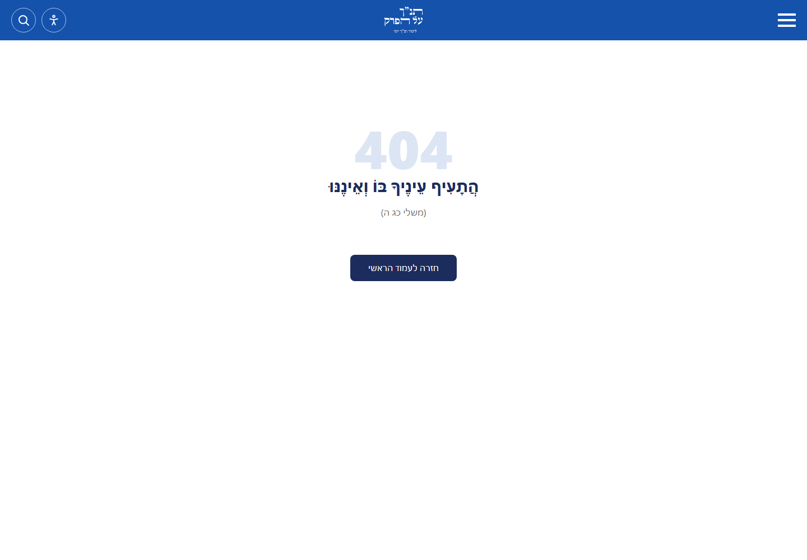
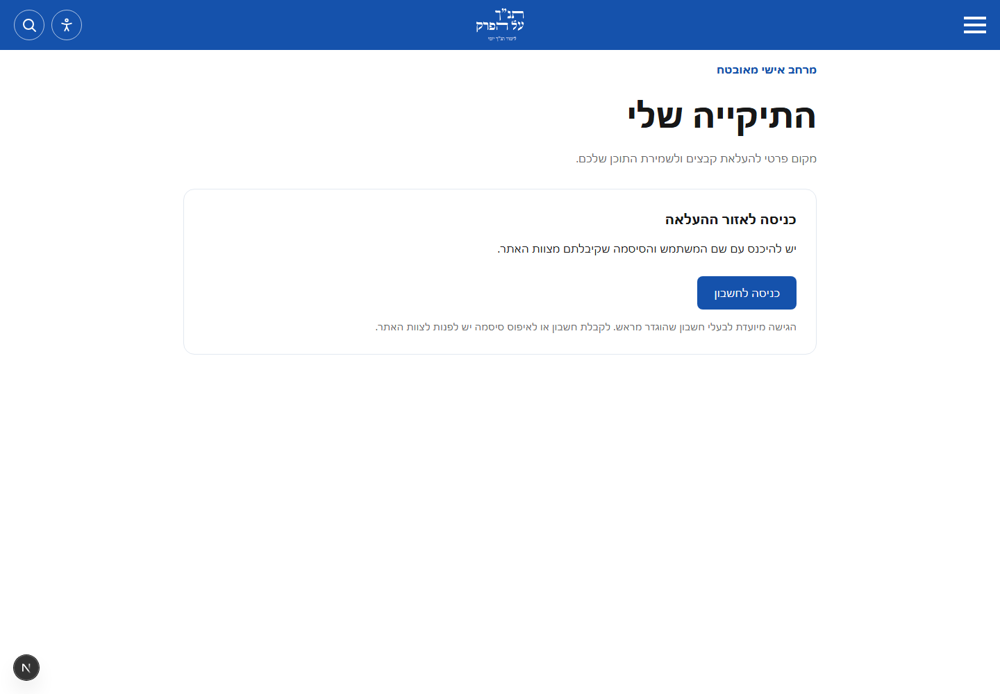
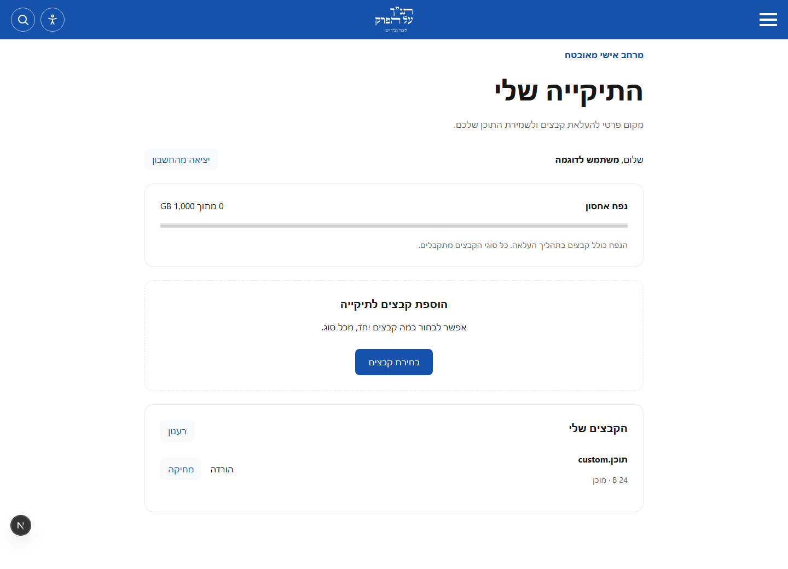
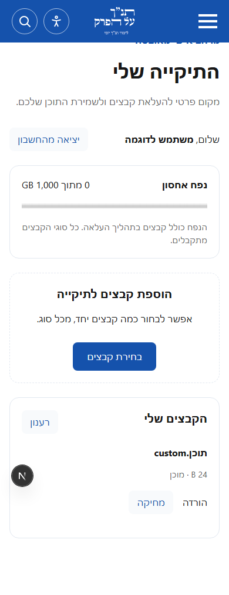

# Private upload area

`/upload` is an unlinked, login-only file area. Cognito accounts are independent
of the admin SSO pool. Users receive a username and temporary password from us,
sign in on Cognito's hosted page, and choose a new password on first login.
They never need AWS accounts. Self-registration and self-service account recovery
are disabled. Create, disable and reset accounts in the Cognito console.

The website server is the only S3 data principal. Browsers never receive AWS
credentials, presigned URLs, bucket addresses or multipart upload IDs. All file
types are accepted, stored as binary data and downloaded as attachments through
an authenticated, ownership-checked endpoint. Do not serve uploads inline.
Object keys use immutable Cognito `sub` and a random file ID, never a username
or filename. Recreating a deleted account does not inherit its old directory.

Quotas use decimal GB: **1000 GB = 1 TB** by default. Admin `/uploads` controls
the global default and optional individual overrides. Users appear there after
their first authenticated directory request. Reservation and quota changes are
serialized with InnoDB locks across all replicas. Pending uploads consume their
full reserved size. Reducing a quota preserves files and blocks new uploads until
enough space is available. Cancel incomplete items in the directory to release
their reservations. S3 also aborts abandoned multipart data after seven days;
the corresponding reservation remains visible until cancelled, preventing
premature reuse if an upload is still in flight. Single files up to 5 TB are
supported when the configured user quota permits them. Part data is streamed;
database connections are not held while clients send file contents.

Reservations are committed before any S3 write, including for empty files.
Preparation failures leave a visible, cancellable reservation. Deletion first
commits a pending-deletion state, then removes S3 data and the row. If its final
commit fails, the row remains pending deletion, cannot be downloaded and can be
cleaned up safely by retrying. Upload transitions use a separate pool of three
database connections, leaving the public-page pool available. Directory pages
contain at most 100 files and use an account-scoped cursor to fetch more.
The cursor includes the last-modified timestamp and ID. Completing a file moves
it to the newest page, and successful uploads return the browser to that page.

OAuth uses authorization code + PKCE and a short-lived, HttpOnly state cookie.
Access and refresh tokens are HttpOnly, scoped to `/upload`, and Secure in
production. Sessions refresh for up to one day; Cognito validates disablement
and revocation for each API request. Mutations require the configured Origin.
The route has robots exclusion, noindex/nofollow/noarchive, no-store responses,
no-referrer and a CSP that prevents third-party analytics requests. It is not
in navigation or the sitemap. These crawler directives complement authentication.

## Approved rollout

**Do not deploy or merge without Dorad's explicit approval of the current PR.**
No live changes are performed by adding these files. Existing public S3 objects,
CDN behavior, URLs, admin authentication and production content stay unchanged.

1. Verify `aws sts get-caller-identity --profile AdministratorAccess-250598594267`
   reports account `250598594267`. Region is `il-central-1`. Describe the current
   website task definition and verify its `taskRoleArn`, role name and image.
   Save the definition and router configuration for rollback. The broad ECS
   template is documentation of the existing stack; do not redeploy it wholesale.
2. Deploy only `docs/aws/cloudformation/private-upload.yaml`, passing the actual
   website role ARN/name and the canonical origin. This adds a retained, encrypted,
   public-blocked bucket, a retained user pool, OAuth client/domain and a narrowly
   scoped policy on the website role. The bucket denies data access to every
   other principal, including the admin role and account administrators. Recovery
   by an administrator requires an explicit bucket policy change. Do not attach
   any Cognito identity pool or give end users IAM credentials.
3. Apply the additive schema with `DB_URL` supplied securely to
   `node devops/private-upload-db.mts`. Run twice to confirm idempotence. Do not
   use the existing db-populator Lambda: it injects destructive DROP statements.
   Earlier upload schemas are upgraded in place: existing file timestamps seed
   the new pagination timestamp, lifecycle states are extended, and the directory
   index is replaced without deleting files, reservations or quota overrides.
4. Deploy the reviewed website/admin images. Add `UPLOAD_AWS_REGION`,
   `UPLOAD_S3_BUCKET`, `UPLOAD_COGNITO_POOL_ID`, `UPLOAD_COGNITO_CLIENT_ID`,
   `UPLOAD_COGNITO_DOMAIN` (hostname only), and `UPLOAD_ORIGIN` (no trailing slash)
   to the website task using the stack outputs. These are configuration, not
   credentials. The reference ECS template documents the same environment.
   The admin uses its existing database connection and needs no private S3 rights.
5. Deploy only the reviewed router changes, validate with `nginx -t`, then reload.
   The private route streams bodies up to 512 MiB, accommodating the adaptive
   chunk size without increasing public-route limits or timeouts. The `.com`
   upload path redirects to the registered `.co.il` Cognito origin.
6. Pre-create two test users in the new pool without an email invitation. Hand
   temporary passwords to their intended recipients outside the repository.
   Verify first-login password change, disabled accounts, token refresh, logout,
   arbitrary and empty files, chunk cancellation, download and deletion. Verify
   anonymous and cross-user requests cannot list, read, delete or complete files;
   private bucket anonymous and administrator reads must be denied. Set a small
   quota in admin and verify parallel uploads cannot exceed it. Restore the
   default to 1000 GB and remove the test accounts/files when finished.

## Impact and rollback

Costs are actual S3 storage/requests, Cognito active users and bandwidth through
the website/EC2 proxy; the 1 TB allowance does not preallocate 1 TB. Passing all
bytes through the service enforces the sole S3 principal requirement, but adds
load to the website and proxy. Measure real upload throughput before widespread
onboarding. No production content is inserted or modified by this feature.

Rollback restores the saved website task definition, previous admin image and
router file, then reloads nginx after validation. Clear upload environment values
to disable the backend. Keep the additive database tables, bucket and user pool
to preserve files and identities. Do not empty the bucket, drop tables or delete
the user pool as part of rollback. Re-enable with the same pool and database to
restore existing directory ownership. Existing public and crawled URLs are
unaffected in both directions.

## Visual verification

Before, the public production `/upload` path returned 404:

The new login view:

Directory previews use synthetic browser responses in the application E2E tests.
The separate MySQL/RustFS integration test verifies actual storage, account
isolation and concurrent quota enforcement.

