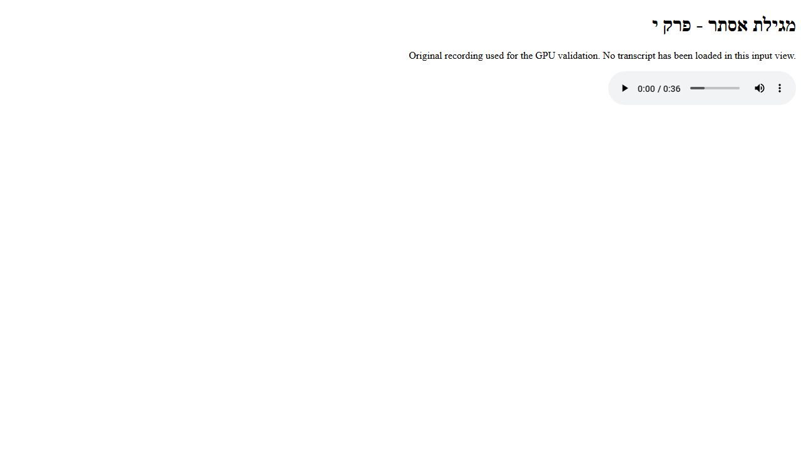

# Transcription validation - 2026-11-11

The captures below establish rendering and short-run functionality. The owner
selected a representative 24-minute lecture in Opus and WebM for the full-length
quality check. Both strict decodes contain 23,393,792 samples (1462.112 seconds),
with no decoded timing offset; they have small acoustic differences.
The [pull request](https://github.com/bible-on-site/bible-on-site/pull/3311)
records the representative-run results and review limits. The supplied lecture
text, audio, video, private paths and full exports remain local.

These are real browser captures of the input and exported output for the same
36.8849-second Esther 10 recording. `before.jpg` shows the original recording
in a minimal local browser media harness. `after.jpg` shows the unmodified
`preview.html` produced by the ordinary CLI with the full pinned Hebrew model
and its default CUDA FP32 settings. The recording's SHA-256 is
`05b1c171298dca95d3f7a69d8c82fd0f815f53c4f6194c04854e20505a73894a`.

The export remains marked for editorial review. The capture establishes the
rendering and pipeline behavior; it does not establish perfect transcription.
The HTML is recognized speech, with only the documented typography and paragraph
formatting applied. The raw transcript and model timestamps remain in JSON.

## Hardware and runtime

Windows, NVIDIA RTX 4070 Laptop GPU (8188 MiB), driver 566.07, Python 3.12.
The final short-run validation used these installed task-local runtime pins:
faster-whisper 1.2.1, CTranslate2 4.9.0, PyAV 19.0.2, NumPy 2.5.4,
Hugging Face Hub 2.4.0, boto3 1.44.0, Windows cuBLAS 12.9.2.10,
cuDNN 9.28.1.4 and NVRTC 12.9.86. `pip check` passed.
The cuDNN number is the installed NVIDIA package version. Runtime snapshots
observed CTranslate2's bundled cuDNN dispatcher 9.10.2.21; they do not establish
which cuDNN component libraries executed. No bundled DLL was replaced.

The model is `ivrit-ai/whisper-large-v3-ct2` at
`e9ed4a4a98d761b0f617d668303de2c514236c66`. Its downloaded model file was
verified against the published SHA-256
`765965efd777190f76e8b337520056f00d68e48bb99b2f95d28670b2364a02ce`.
All final runs used cached weights with `--offline`, the full model, beam 5,
native long-form decoding, previous-text context, standard temperature fallback,
and no VAD trimming or precision/model fallback.

| Input | Default precision | Elapsed | Measured peak GPU usage |
| --- | --- | --- | --- |
| 36.8849-second original MP3 | FP32 | 28.140 s | 7113 MiB |
| 65-second WAV | FP32 | 33.141 s | 7465 MiB |
| 65-second MP4 with AAC audio | FP32 | 30.859 s | 7433 MiB |

Each run exited 0 and exported all three artifacts. The MP3 run used a Hebrew
output directory with the default Windows pipe encoding, verifying the UTF-8
console repair without environment overrides. GPU usage was sampled with
`nvidia-smi` during otherwise idle-device validation. Elapsed times include
local model loading and export, exclude the initial model download, and are
functional smoke measurements rather than performance gates.

Full-length measurements require an exclusive GPU window, with all compute PIDs
recorded throughout. Two initial lecture attempts overlapped another local LLM
task and are classified as confounded; they do not establish standalone FP32
capacity, throughput or transcription quality. No allocator or model change was
promoted from those measurements.

An earlier explicit FP16/FP32 comparison on the same short recording produced
byte-identical `article.html`. No word-error-rate improvement is claimed from
changing precision. FP32 prioritizes arithmetic precision. The complete lecture
exceeded this 8 GiB GPU's dedicated memory even without another compute process;
short-run headroom did not establish full-length capacity.

## Representative lecture - 2026-11-12

The full 1462.112-second Opus lecture completed with explicit FP16, using the same
pinned full model, beam 5, context, temperature fallback and complete decoded audio.
All three artifacts were exported in 906.469 seconds: 24.37 track minutes in
15.11 pipeline minutes, or 1.61 track minutes per runtime minute. The sampled
per-process dedicated-memory peak was 5167 MiB, with 76 MiB shared; no foreign
compute PID was observed. The final raw segment ends at 1461.24 seconds.

The export contains 423 segments, 3472 words and 29 paragraphs. A real browser
capture of that complete local preview was reviewed and retained privately.
The source and article hashes remain in its local manifest. Its text is an
unedited transcription requiring human listening and editorial review.

Among 11 shared prefix windows, FP16 and FP32 produced 9 identical text windows
and 14 word edits across 675 FP32 words. Neither output is a reference transcript;
this measures disagreement, without establishing WER or a precision advantage.
The completed FP16 output has no adjacent identical segments of eight or more
words. Mechanical diagnostics do not establish recognition accuracy.

FP32 remains the explicit default and no allocator or backend experiment was
promoted. The guide documents the tested FP16 invocation for this 8 GiB GPU.

The full WebM counterpart also completed with explicit FP16: 750.407 seconds
(12.51 pipeline minutes), or 1.95 track minutes per runtime minute. It exported
481 segments, 3448 words and 29 paragraphs, ending at the same estimated
1461.24-second boundary. Its sampled dedicated-memory peak was 5071 MiB, shared
memory was 76 MiB, and no foreign compute PID was observed. Both source hashes
and both article hashes were independently verified. Small acoustic differences
and native sampling fallback mean the two transcriptions can differ.

The observed floating-point-only overlap in the original Opus manifest was
reproduced and fixed without rounding saved timestamps. Re-exporting both saved
recognitions produces no timestamp warnings and preserves every raw segment and
article content hash. Both complete original CLI runtimes above remain unchanged.

## Automated checks

All 91 tests pass with the real S3 SDK and media integrations enabled, with
99% branch-aware coverage and every production source line covered. Tests
generate their own WAV/video/multi-track/corrupt-media fixtures. Real boto3
transport is constrained to a loopback-only server; no production AWS identity,
endpoint, bucket or archive file is used. Existing CI routing tests also pass
(190 cases), including local-tool deployment isolation.

See [the pipeline guide](../../../devops/transcription/README.md) for commands,
the archive access constraint, artifact schema and future draft handoff.
