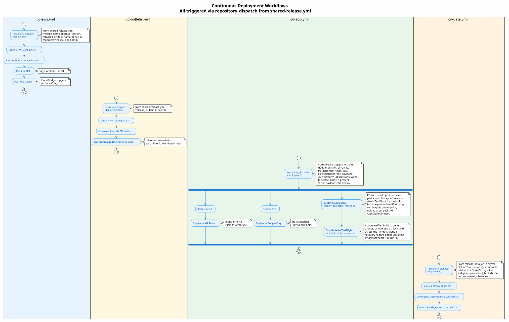

# CD Workflows

All CD workflows are triggered via `repository_dispatch` events from CI after successful builds.

Dispatches queue per production target without canceling an active deployment.
Before production writes, the workflow checks its source CI run and immutable
commit, and skips a dispatch superseded by a newer release. Artifact download and
source checkout use the same CI run/commit; Data also uses an immutable SHA.
See [version and deployment concurrency](../../version-verification.md#concurrent-releases-and-deployment).

| Workflow | Trigger Event | Purpose |
|----------|---------------|---------|
| [`cd-aws.yml`](../../../../.github/workflows/cd-aws.yml) | `deploy-aws` | Deploy Website/API/Admin Docker images to AWS ECR → ECS |
| [`cd-bulletin.yml`](../../../../.github/workflows/cd-bulletin.yml) | `deploy-bulletin` | Deploy Bulletin Lambda ZIP to AWS Lambda |
| [`cd-app.yml`](../../../../.github/workflows/cd-app.yml) | `deploy-app` | Deploy app to Google Play, Microsoft Store & TestFlight |
| [`testflight-distribution.yml`](../../../../.github/workflows/testflight-distribution.yml) | `workflow_call` from cd-app / manual | Distribute the verified iOS build to TestFlight groups |
| [`testflight-status.yml`](../../../../.github/workflows/testflight-status.yml) | `workflow_call` / manual | Read-only inspection of a published iOS build (recovery aid) |
| [`cd-data.yml`](../../../../.github/workflows/cd-data.yml) | `deploy-data` | Deploy data updates to production database |

## AWS Deployment (`cd-aws.yml`)

Triggered by `shared-release.yml` after Website or API release.

**Flow:**
1. Restore Docker image artifact from CI run
2. Push to AWS ECR with version tag + `latest`
3. ECS auto-deploys via EventBridge (watches `latest` tag)

**Deployment resilience:** With a single ECS task (`DesiredCount: 1`), rolling updates may briefly interrupt traffic. If zero-downtime deployments become necessary, consider running the service with **at least 2 tasks** so one stays up while the other is replaced. See [Deployment incident analysis 2026-02-10](../../../aws/deployment-downtime-2026-02-10.md) for background and options.

## Bulletin Deployment (`cd-bulletin.yml`)

Triggered by `shared-release.yml` after Bulletin release.

**Flow:**
1. Download the pre-built Lambda ZIP artifact from CI
2. Configure AWS credentials (OIDC)
3. Deploy ZIP to Lambda function `bible-on-site-bulletin` via `aws lambda update-function-code`

**Notes:**
- The bulletin Lambda is a Rust binary compiled for `aarch64-unknown-linux-musl` (ARM64)
- Lambda Function URLs are not available in `il-central-1`; the website invokes the Lambda directly via AWS SDK

## App Deployment (`cd-app.yml`)

Triggered by `release_app` job in `ci.yml` after App CI passes. The release
payload carries five artifacts — `msix`, `aab`, `ipa`, `ios_assetpacks`,
`ios_payloads` — plus `ci_run_id`/`module_version`; each platform job runs
only when its artifact name is present, so a partial store payload still
deploys the platforms it has.

**Platforms:**

| Platform | Store | Artifact | Track |
|----------|-------|----------|-------|
| Android | Google Play | `.aab` | Internal |
| Windows | Microsoft Store | `.msix` | Flight |
| iOS | TestFlight | `.ipa` + `.aar` asset packs | App Store Connect → group distribution |

**iOS flow** (`deploy_app_store` on `macos-15`, #2234):
1. Check deployment source/freshness, restore the exact `.ipa` and `.aar`
   asset packs from the `app-v<version>` GitHub Release
2. Check whether TestFlight already holds the exact build → upload once via
   `fastlane pilot` when missing → verify Apple accepted and processed that
   build → upload the managed asset packs to App Store Connect
   (Background Assets)
3. `distribute_app_store` then calls `testflight-distribution.yml`, which
   assigns the verified build to TestFlight tester groups. The shared app-CD
   lock is held across the handoff; a manual recovery dispatch of either
   workflow shares the lock without deadlocking the parent run.

Each platform deploy is independent: a failure on one store does not roll
back the others, and re-dispatching `deploy-app` (or a manual run of
`cd-app.yml`/`testflight-distribution.yml`/`testflight-status.yml` with the
artifact name and CI run id) resumes only the missing piece — partial-store
failure recovery is by design, not a manual rebuild.

## Data Deployment (`cd-data.yml`)

Triggered by `release_data` job in `ci.yml` after Data CI passes.

Tanahpedia/schema-only changes intentionally skip the perushim generation job. The
release gate accepts that `skipped` result and binds the current run's non-expired
`perushim-data-sql.master` artifact by immutable ID and SHA-256 digest. A skipped perushim job must never suppress a
detected data deployment.

**Flow:**
1. Validate the dispatch's source and freshness, then download and verify its pinned SQL archive
2. Configure AWS credentials (OIDC)
3. Validate and run data migration scripts against production RDS

Every SQL file in the deploy manifest must pass
`python devops/deploy/data-deploy/validate_lambda_parser.py --parse-only` in Data CI. Tanahpedia schema
changes are deployed and verified in a schema-only change before an API or website
release starts querying the new schema.

## Architecture

