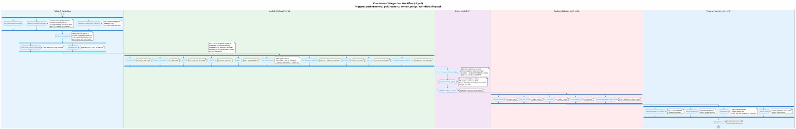

# CI Workflow

| Workflow | Purpose |
|----------|---------|
| [`ci.yml`](../../../../.github/workflows/ci.yml) | Main CI pipeline (detect, test, package, release, dispatch CD) |
| [`app-mobile-e2e.yml`](../../../../.github/workflows/app-mobile-e2e.yml) | Native E2E orchestrator — resolves perushim input, plans runtime-balanced iOS shards, fans out Android and shared-build + planned iOS legs, merges iOS results |
| [`app-mobile-e2e-runner.yml`](../../../../.github/workflows/app-mobile-e2e-runner.yml) | Reusable native leg — one Android `build-and-run`, one iOS `build`, or one iOS `prebuilt-run` shard |
| [`shared-dockerize.yml`](../../../../.github/workflows/shared-dockerize.yml) | Docker image packaging |
| [`app-package.yml`](../../../../.github/workflows/app-package.yml) | App packaging (MSIX, AAB, IPA + asset packs/payloads) |
| [`shared-release.yml`](../../../../.github/workflows/shared-release.yml) | Release automation (tag, GitHub Release, trigger CD) |
| [`ci-data-deploy.yml`](../../../../.github/workflows/ci-data-deploy.yml) | Data-deploy tooling tests (path-scoped, independent of `ci.yml`) |
| [`perek-images.yml`](../../../../.github/workflows/perek-images.yml) | Perek image tooling checks (path-scoped `devops/perek-images`, independent) |
| [`testflight-distribution.yml`](../../../../.github/workflows/testflight-distribution.yml) | TestFlight group distribution; also dispatchable for recovery |
| [`testflight-status.yml`](../../../../.github/workflows/testflight-status.yml) | Read-only inspection of the published iOS build (recovery aid) |
| [`auto-create-pr`](../../../../.github/workflows/auto-create-pr.yml) | Auto-create PRs when publishing a branch |
| [`codeql.yml`](../../../../.github/workflows/codeql.yml) | CodeQL analysis (independent check) |
| [`dependency-review.yml`](../../../../.github/workflows/dependency-review.yml) | PR dependency review (independent check) |
| [`dependency-submission.yml`](../../../../.github/workflows/dependency-submission.yml) | Dependency snapshot submission |
| [`xcode-mcpbridge-poc.yml`](../../../../.github/workflows/xcode-mcpbridge-poc.yml) | Diagnostic PoC for Xcode's mcpbridge device driver (dispatch only) |

## Triggers and concurrency

`ci.yml` runs on `push` to `master`, on `pull_request` to `master`, on
`merge_group` (merge-queue validation), and on `workflow_dispatch`. The
concurrency group `ci-<event>-<pr-or-run-id>` cancels superseded runs of the
same pull request only; `master`, dispatched and merge-queue runs are unique
groups and are never cancelled by this rule.

`ci-data-deploy.yml` is separate: it validates the data-deployment tooling and
triggers on its own path filter (`devops/deploy/data-deploy/**`,
`devops/package.json`, itself) for PRs, master pushes and merge-queue checks.

## Pipeline Stages

### 1. Setup & Detection

- **Setup Environment Variables** (`setup_env`): resolves tool versions
  (e.g. Playwright) and module paths used by every other job.
- **Determine Baseline Availability** (`determine_baseline_availability`):
  checks which trusted `master` artifacts exist, downloads each via the
  REST API and re-uploads it into the current run so consumers resolve
  baselines through ordinary `actions/download-artifact`. Covered baselines:
  per-module coverage (`{website,api,app,bulletin,admin,data}-coverage.master`),
  perushim data (`perushim-data-sql.master`,
  `perushim-sqlite-v2-indexed.master`) and per-platform app E2E coverage
  (`app-e2e-coverage.master.{android,ios}`).
- **Determine Docker Image Availability**
  (`determine_docker_image_availability`): checks the cached LCOV Docker
  artifact and the GHCR Sefaria MongoDB image (tagged by the git tree hash of
  `data/sefaria/mongodb-docker`); computes `can_publish_sefaria_mongo` (fork
  PRs get a read-only token and cannot push to GHCR).
- **Determine Changes** (`determine_changes`): one job running
  [`determine-changes.ts`](../../../../devops/github/ci/determine-changes.ts),
  which diffs the event's base revision (merge parent for PRs,
  `merge_group.base_sha` for the queue, `before` for pushes) and emits
  `<module>_module_changed` / `<module>_ci_changed` for every module.
  - `module_changed` means released content changed → package/release/bump.
  - `ci_changed` additionally covers test-only and tooling paths
    (`ciOnlyPattern`, `extraCiPattern`, `ciPaths`): a change that only touches
    tests or CI runs the module's checks but must not ship a release
    (#2210/#2132 — e.g. `web/bible-on-site/tests/**`,
    `app/BibleOnSite.Tests*/**`, `app/mobile-e2e/**`).
- **Build LCOV Docker Image** (`build_lcov_docker`): rebuilds the coverage
  image only when the cached artifact is missing.
- **Build Sefaria MongoDB Docker Image** (`build_sefaria_mongo_docker`):
  publishes the Data integration-test MongoDB image to GHCR, tagged by the git
  tree hash of `data/sefaria/mongodb-docker`, only when that tag is missing.
  Fork PRs receive it as a run artifact instead.

### 2. CI Jobs (Conditional)

Each module job runs only when its trigger fires: the module changed OR its CI
paths changed OR the module's trusted baseline is missing (a missing baseline
forces a full recovery run that republishes it). `needs` results are checked
explicitly (`always()` + `!failure()`) so a skipped prerequisite cannot
silently green a suite.

| Job | Key | Module | Tests |
|-----|-----|--------|-------|
| Website CI | `website_e2e` | `web/bible-on-site` | Lint, unit, E2E (coverage) — dev-server E2E, no production build |
| Website Performance | `website_performance` | `web/bible-on-site` | Lighthouse + production build / standalone server |
| API CI | `api_e2e` | `web/api` | Lint, fmt, unit, E2E (llvm-cov) |
| Admin CI | `admin_ci` | `web/admin` | Lint, typecheck, unit, E2E (coverage), local S3/RustFS checks |
| App CI | `app_ci` | `app` | Lint, unit, integration (coverage) |
| App Mobile E2E | `app_mobile_e2e` | `app` | Reusable → [`app-mobile-e2e.yml`](../../../../.github/workflows/app-mobile-e2e.yml) — Appium suite on Android + iOS (see below) |
| App iOS native audio CI | `app_ios_ci` | `app` decoder (app-owned manifest verified by the website suite) | **PR only** — Playwright WebKit/Chromium recitation checks; `skipped` accepted elsewhere |
| Bulletin CI | `bulletin_ci` | `web/bulletin` | Lint, fmt, unit (coverage) |
| Data CI | `data_ci` | `data` | Lint, unit, integration (Sefaria MongoDB image) |
| Recitation alignment and RustFS | `recitation_ci` | `data`/`website` decoder | Alignment invariants, preprocessor, deploy-routing and RustFS storage tests |
| Perushim Data | `perushim_data` | `data/sefaria/pipelines/perushim-view` | Producer job — regenerates `perushim-data-sql` + `perushim-sqlite-v2-indexed` artifacts consumed by website/app jobs |

**Differential E2E selection (#2085, shadow mode):** every E2E job downloads the
suite's coverage-tree baseline and computes a selection manifest while the
suite still runs everything (`select`/`baseline-download` +
`collect-playwright`/`collect-appium`, all in
[`devops/github/ci/e2e-impact/`](../../../../devops/github/ci/e2e-impact/) and
[`devops/e2e-coverage-trees/`](../../../../devops/e2e-coverage-trees/)).
Selection **enforcement is opt-in**: only the mobile workflow exposes
`e2e_selection_mode=enforce` / `force_full_suite` inputs. See
[E2E impact selection](../../../tests/app/e2e-impact.md) and the
[coverage-tree spec](../../../devops/e2e-test-selection.md).

### 3. Cross Module CI (`cross_module_ci`)

- **Check Prerequisites** — the required merge gate, failing closed:
  - The detection jobs (`determine_changes`, `determine_baseline_availability`,
    `determine_docker_image_availability`) must succeed — module jobs skip
    silently when they fail, so an unchecked failure would pass untested.
  - Every suite whose own trigger fired (`<module>_module_changed`,
    `<module>_ci_changed`, or a missing coverage/Docker-image baseline) must
    report `success` — a failed, skipped, or cancelled triggered suite still
    blocks the merge. Only a suite whose trigger did not fire may pass untested.
  - `app_ios_ci` (native audio) is the one exception: it runs on PRs only, so
    `skipped` is accepted on other events.
  - `package_api` / `package_bulletin` / `package_admin` must succeed on every
    non-`push` event (PR, merge queue, dispatch) where that module's
    `module_changed` or `ci_changed` fired — the release Docker build is a
    pre-merge check.
  - `recitation_ci` is required when data/website-affecting changes exist;
    `perushim_data` must succeed when the pipeline changed or a perushim
    baseline is missing.
- Restores per-module coverage — from the module job's own run artifact when
  it ran, else from the re-uploaded `*.master` baseline.
- Merges the **app** report's three layers — unit + integration + per-platform
  mobile E2E (`merge-lcov.mts --relocate app/BibleOnSite/ --hits-only`):
  executed-hit records union in, the instrumented build's larger zero-hit
  universe is dropped so it cannot inflate the flag's denominator (#2271);
  a successful `app_mobile_e2e` must contribute both platform reports.
  The combined report is stored as `app-coverage.<run>` and, on master,
  replaces `app-coverage.master`.
- Runs the devops test suites (`bun run test:version`, `determine-changes`,
  `e2e-impact`, `e2e-coverage-trees`, `codecov-report-state`,
  `bencher-comparison` tests).
- Publishes per-flag coverage to Codecov (`website`, `api`, `app`, `bulletin`,
  `admin`, `admin_e2e`, `data`) and the cross-module merge to Codacy, then
  polls Codecov's report state (`codecov-report-state.mjs`) — distinguishing
  pass, explicit fail, and unresolved/outage paths.
- `website_publish_test_results_to_codecov` uploads the website's JUnit
  results as a Codecov `test_results` report.

### 4. Packaging (Master `push`; API, Bulletin, Admin also pre-merge)

`package_api`, `package_bulletin` and `package_admin` also run on PR, merge-queue and dispatch
events whenever their module's `module_changed` or `ci_changed` fires. Those
runs execute the exact release Docker build (same Dockerfile, `web` context,
`DOCKER_BUILDKIT=0`) but skip every artifact upload, so nothing is released
or deployed; `cross_module_ci` gates them under the same triggers. Any
Dockerfile under a module dir counts as `module_changed`; the shared
`web/.dockerignore` context, `shared-dockerize.yml` (API) and
`web/api/entities` (compiled into the Bulletin image) count as `ci_changed`.
Package Website stays master-only: its SSG image build reads the production
DB (SSM + RDS allow-listing), which PR runs must not access; Website
Performance builds the same Next.js app pre-merge.

| Job | Kind | Output | Purpose |
|-----|------|--------|---------|
| Package Website | `shared-dockerize.yml` | Docker `.tar.gz` | AWS ECS |
| Package API | `shared-dockerize.yml` | Docker `.tar.gz` | AWS ECS |
| Package Admin | inline | Docker `.tar.gz` | AWS ECS |
| Package Bulletin | inline | Lambda `.zip` | AWS Lambda |
| Package App | `app-package.yml` (needs `perushim_data`) | MSIX + AAB + IPA + iOS asset packs (`.aar`) + payloads | Stores / TestFlight |

### 5. Release (Master `push` only)

- `release_website`, `release_api`, `release_admin`, `release_bulletin`,
  `release_app` — each requires `cross_module_ci` + its `package_*` success,
  runs `shared-release.yml`: tag + GitHub Release + `repository_dispatch` to
  the module's CD event (`deploy-aws` / `deploy-bulletin` / `deploy-app`).
  The app release hands five artifacts to CD: MSIX, AAB, IPA, asset packs,
  payloads (see [CD](../cd/cd.md)).
- `release_data` — resolves the pinned SQL archive (this run's perushim
  artifact or the bound master baseline) and dispatches `deploy-data`.
- `bump_versions` — after any release, publishes the next version bump on
  master (`[skip ci]`), with collision-retry publication when a tag exists
  elsewhere. See [version-verification.md](../../version-verification.md).

## Native E2E (`app-mobile-e2e.yml` + `app-mobile-e2e-runner.yml`)

The reusable orchestrator composes one orchestration layer over reusable legs:

```
resolve_perushim_input  →  appium_android (runner: build-and-run)
                        →  build_ios      (runner: build)
                        →  plan_ios       (select -> runtime plan -> ios-matrix)
                        →  ios_shard_<N>  (runner: prebuilt-run, needs
                                         build_ios + plan_ios)
merge_ios (always(), needs every planned shard)
```

- **Leg contract** ([`app-mobile-e2e-runner.yml`](../../../../.github/workflows/app-mobile-e2e-runner.yml)):
  `android_build_and_run` runs on `ubuntu-latest` with a warm AVD snapshot
  (booted emulator + state, keyed by the config recipe +
  `KVM-EMU-PACKAGE`/`SDK-PACKAGE`, saved only on trusted pushes);
  `ios_build` / `ios_prebuilt_run` run on `xcode-27` (arm64, Xcode 27).
  iOS is split into a single shared build plus a `plan_ios`-decided number
  of independent `prebuilt-run` shards (#2263); each leg lives inside its own slice of
  `app/.artifacts/mobile-e2e/<platform|ios-shardN>/`, so per-leg caches,
  diagnostics and merge artifacts never collide.
- **Shared iOS build** (#2266): `ios_build` compiles the app once, uploads
  `app-mobile-e2e-build.<run>.ios`, each shard restores it byte-for-byte and
  rewrites embedded `artifact_upload_base_url`/`artifact_key`/`run` markers
  (`rewrite-shared-app-runtime-markers.mjs`) before validating the runtime
  directories against the build's checksum manifest.
- **Sharding** (#2263): `plan_ios` selects the affected iOS cases once and
  assigns them to runtime-balanced shards; each leg executes exactly its
  assigned `case-manifest.json`, and union validation in
  `merge-runner-shards.mjs` proves no planned scenario is dropped or
  duplicated before any merge output is trusted.
- **Merge leg** (`merge_ios`): requires every planned shard's pilot
  `success`, verifies each shard's manifest equals its plan assignment and
  the disjoint union covers the planned run set,
  merges per-shard LCOV into `app-e2e-coverage.<run>.ios`, then publishes
  `app-mobile-e2e-coverage.master.ios`,
  `app-mobile-e2e-exec-coverage.master.ios`, and
  `appium-ios-master-<attempt>` only when the merged evidence is
  `complete` — and only on a `push` to `master`; a `workflow_dispatch` does
  not refresh baselines. Diagnostic/provisional per-test artifacts are still
  uploaded from PR runs, but never as baselines.
- **Session lifecycle per leg** (#2248/#2253/#2255): resolve/simctl-create the
  device → start async boot + shared state restore in parallel with node/bun
  restore, Appium/WDA agent prep, and (iOS) shared-build download → the pilot
  waits on every started gate before `Run ... shard`. The harness keeps one
  Appium session per xUnit device-collection and replays the identical
  per-test wipe inside it (terminate → remove → install → activate), so only
  a transport failure builds a fresh WDA session. A supervisor watchdog plus
  per-test/batch deadlines bound runaway legs; cleanup captures diagnostics,
  deletes the cloned device, and reports the bounded outcome.
- **Perushim input** (orchestrator `resolve_perushim_input`): shards and the
  Android leg package the same `perushim-sqlite-v2-indexed` catalog/notes pair
  `package_app` ships — this run's artifact when the pipeline regenerated it,
  the `master` baseline otherwise.

## Cache and reuse strategy

All caches are owned by the native runner legs (plus `actions/cache` inside
`ci.yml` for NuGet/bun). Keys are derived on every leg by `hash-native-deps.mjs`
/ `nuget-cache-key.ts` (bounded `hashFiles` — the manifest file is hashed
directly when the file enumeration budget would be exceeded, #2184). Save
policy differs per cache: NuGet, node_modules and iOS `obj` intermediates save
only on `refs/heads/master`; the AVD snapshot, Android SDK and MAUI workload
caches are event-gated (`!= pull_request && != merge_group`, so a dispatch on
any branch may save); the iOS simulator state saves whenever the quiesce step
succeeds — its key is content-scoped (toolchain id + device recipe), so a PR
save can only rewrite the state that same key already describes.

| Cache | Key content | Notes |
|-------|-------------|-------|
| NuGet | `nuget-key-mac` recipe (maui package families + versions) | Restored on every leg |
| `app/mobile-e2e/node_modules` | `node-modules-<node>-<bun-lock sha>` | Exact hit skips `bun install --frozen-lockfile` |
| MAUI workloads | workload recipe + `WorkloadMauiInfo` stamp | Version probe skipped on `hit=exact` (was ~6-7min); cached `<sdk>.<band>-workloads.json` is sanity-checked against the actual installed set |
| `BibleOnSite` obj + NuGet intermediates | `obj-<deps>-<stamp>` recipe | `app/BibleOnSite/obj` itself is excluded — stale signed intermediates break codesign |
| iOS simulator state | toolchain id + device recipe + `tests.sqlite` signature | `Finish ... simulator setup` replays ownership/battery flags, `simctl bootstatus`, validates the clone |
| Android AVD state | config recipe + emulator/SDK package stamps | One snapshot: booted state, system certs, resolved marker |
| Android SDK | license fingerprint + `SDK-PACKAGE` recipe | Save trusted pushes only |
| Playwright browsers | `playwright-<version>` (+ webkit variant for `app_ios_ci`) | Version pinned by `setup_env` |
| Docker LCOV image | action-cache artifact `github-workflow-lcov` | Rebuilt only on miss |

Toolchain identity is stamped into every key via
`compute-ios-toolchain-id.mjs` / `hash-native-deps.mjs`, so Xcode/macOS/Node
drift invalidates caches instead of restoring mismatched state.

## Architecture


## Known Issues & Workarounds

### Reusable Workflow Result Evaluation Bug (GitHub Actions)

**Issue Reference:** [#1065](https://github.com/bible-on-site/bible-on-site/issues/1065)

**Problem:** GitHub Actions has a known issue where jobs depending on reusable workflows may be incorrectly skipped, even when the reusable workflow completes successfully. The `needs.X.result` and `needs.X.outputs.*` values don't propagate reliably in all cases.

**Symptom:** Release jobs (or other downstream jobs) get skipped with no clear reason, even though their upstream packaging jobs ran successfully.

**Workaround:** Use `always()` combined with explicit result checks in the `if` condition:

```yaml
# ❌ DON'T - May cause job to be skipped incorrectly
if: ${{ needs.package_website.outputs.module_version != '' && ... }}

# ✅ DO - Reliable pattern
if: ${{ always() && needs.cross_module_ci.result == 'success' && needs.package_website.result == 'success' && needs.package_website.outputs.module_version != '' && ... }}
```

**Rule: When Adding New Jobs That Depend on Reusable Workflows:**

1. **Always use `always()`** at the start of the `if` condition
2. **Explicitly check `.result == 'success'`** for ALL upstream reusable workflow jobs
3. **Then add your business logic conditions** (outputs, branch checks, etc.)

**Example - Adding a new release job:**
```yaml
release_new_module:
  name: Release New Module
  needs: [setup_env, determine_changes, cross_module_ci, package_new_module]
  # Note: Using always() + output check as a workaround for reusable workflow result evaluation issues (see #1065)
  # Also verify cross_module_ci and package_new_module passed to ensure quality gate
  if: ${{ always() && needs.cross_module_ci.result == 'success' && needs.package_new_module.result == 'success' && needs.package_new_module.outputs.module_version != '' && needs.determine_changes.outputs.new_module_module_changed == 'true' && needs.setup_env.outputs.is_master_branch == 'true' && github.event_name == 'push' }}
```

**Affected Jobs:** `release_website`, `release_api`, `release_admin`, `release_bulletin`, `release_app`

### Release Docker builds must run before merge (#2292)

**Incident:** [#2291](https://github.com/bible-on-site/bible-on-site/pull/2291)
bumped both Rust Dockerfiles to `rust:1.99.1-alpine` while that tag's manifest
list only had a `linux/arm64` image. Master run
[38809061508](https://github.com/bible-on-site/bible-on-site/actions/runs/38809061508)
failed both Package API and Package Bulletin at `FROM`: `no matching manifest
for linux/amd64 in the manifest list entries`. The PR
([38806417211](https://github.com/bible-on-site/bible-on-site/actions/runs/38806417211))
and merge-queue ([38807727130](https://github.com/bible-on-site/bible-on-site/actions/runs/38807727130))
runs were green because `package_*` only ran on master `push`, and the module
CI jobs build natively with `cargo`, never pulling the Dockerfile base image.

**Rule:** a release build path (Dockerfile, base image, build context) must
be exercised before merge. A packaging job that only runs on master `push`
needs a non-`push` validation run that skips publication, gated in
`cross_module_ci` under the job's own module/CI triggers.

### Draft release lookup and recovery

GitHub's release-by-tag endpoint returns published releases. For an interrupted
draft, use the authenticated, paginated release listing to find the exact tag;
authorization and transport failures must stop recovery. After the release action
uploads assets, use its numeric release ID to read and publish that draft only
after local files match every expected uploaded asset's size and digest.

Rerunning the same source resumes its draft. A published release retains its
original artifacts, source CI run and attempt. A different source using that
version must take the normal collision bump; never move its tag or overwrite its
published assets.

If an older workflow still uses the published-only endpoint and cannot resume its
draft, verify the original passing source quality, tag/source/attempt metadata,
Actions archive IDs and hashes, and all release asset bytes before publishing by
ID. Then rerun only the failed release jobs: their published-release path replays
the original payload and lets the normal CD guards and queued master version
publisher finish recovery.

See [GitHub's release API](https://docs.github.com/en/rest/releases/releases) and
validate changes with `bun run test:version` in `devops`.

TestFlight delivery reads the app identity, marketing version, and build number
from the published IPA and checks that exact iOS build through Apple's API.
An existing valid build resumes distribution without another binary upload.
Processing builds are polled; rejected builds and API errors fail the delivery.
If an earlier recorded delivery exists and Apple cannot confirm its build, a
retry does not upload again. Keep the original uploader error visible and use
the read-only **Inspect TestFlight build** workflow to inspect the published
release before recovery. The normal source, quality, freshness, and deployment
ledger guards still apply to every production write.

After a verified upload, app CD calls the separate **Distribute TestFlight build**
workflow. It specifies the iOS platform and both the exact app version and build
number. Upload and distribution have independent `app-ios` and `app-ios-beta`
deployment records. A distribution error fails its own job and record while
preserving the verified upload's success.

Retry distribution alone by manually running that workflow on `master` with the
published `ios_artifact_name` and its source `ci_run_id`. This recovery shares
the app CD lock, retains the source/quality/freshness guards, and verifies Apple's
exact build through the published IPA. It contains no binary upload step. A
successful repeated distribution skips all writes; a superseded release also
skips recovery. This implements
[issue #1183](https://github.com/bible-on-site/bible-on-site/issues/1183).
See [Apple's build query](https://developer.apple.com/documentation/appstoreconnectapi/get-v1-builds)
and [Fastlane's upload/distribution options](https://docs.fastlane.tools/actions/pilot/).
