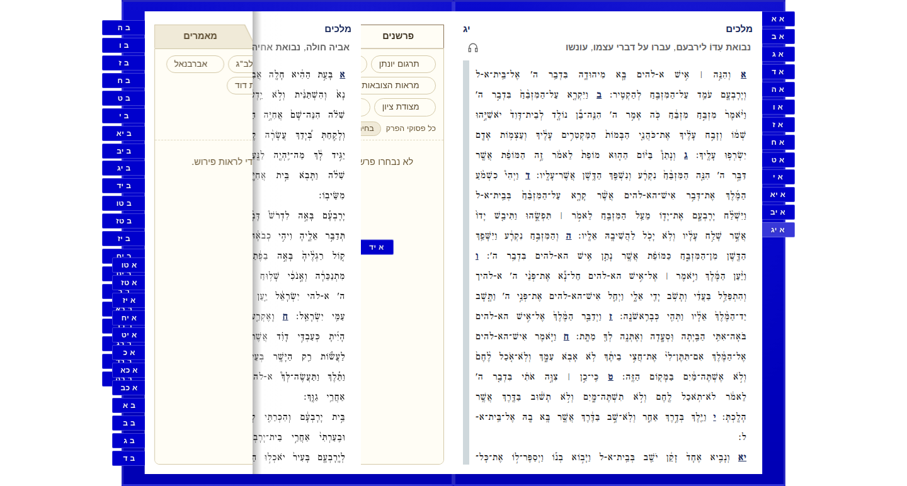
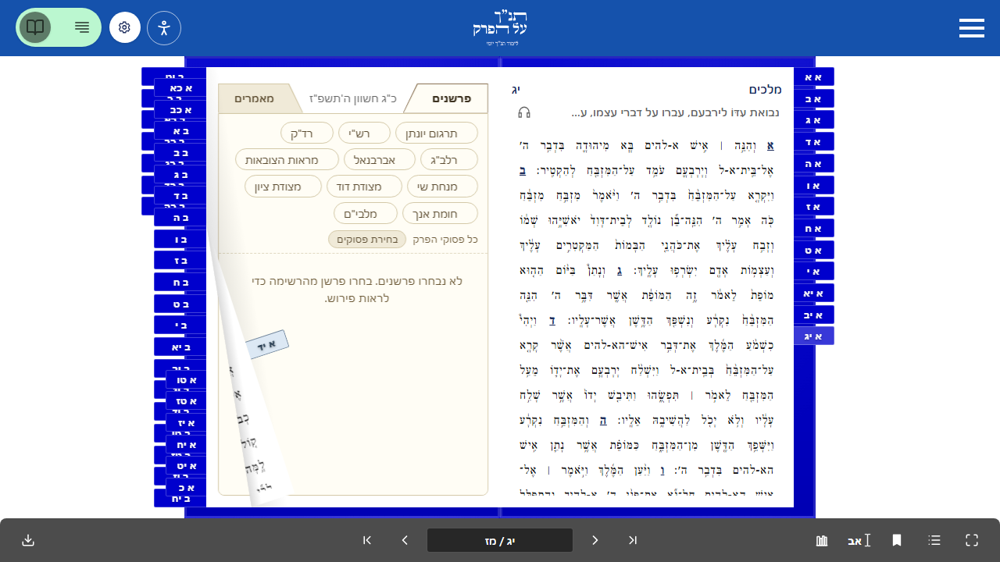
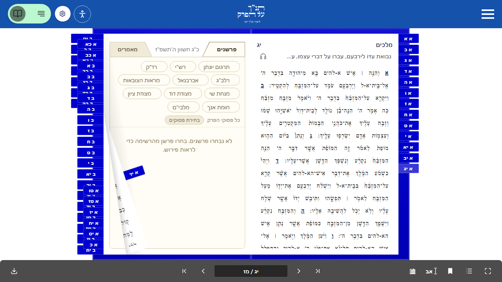
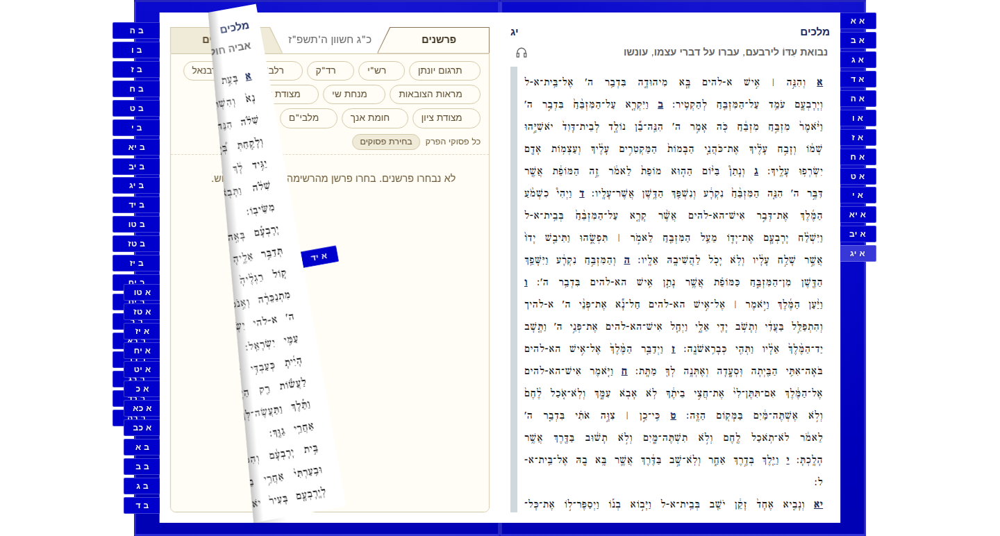
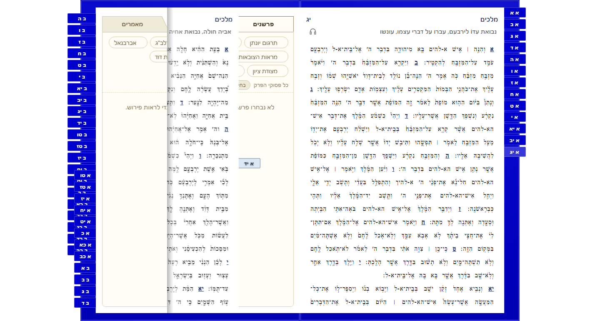

# Sefer turn performance guard

`web/bible-on-site/tests/perf/sefer-consecutive-turns.test.ts` exercises the
first turn and immediate consecutive turns independently. It covers במדבר and
מלכים, moving/pinned/hidden bookmarks, and native drag/toolbar input. Moving
bookmarks must pass on their first turn as well as after a previous turn.

The candidate reader consumes the normally published alpha.111 packages and
reuses stable paper-pane rendering while the crease moves. Unchanged bookmark-label children
are reused as well. A matched diagnostic reduces painting work by 11-15% at 6x
CPU slowdown; that experiment is not release qualification. All eight resting
images and eight character-position comparisons are exact. Text styles, colors
and controls stay intact; motion font smoothing is accepted by Dorad.

A normal-speed comparison uses the same desktop Chrome, graphics driver,
1440x900 viewport, six native turns and zero retries for the live 0.2.620 reader
and the candidate. The public version stayed 0.2.620 throughout. All original
samples are retained in the [desktop baseline](sefer-turn-performance.desktop-baseline.json).

| Normal desktop measurement | Live 0.2.620 | Candidate |
| --- | --- | --- |
| Worst response p95 | 115.1ms | 71.7ms |
| Worst first-turn frame-gap p95 | 50ms | 16.9ms |
| Worst consecutive-turn frame-gap p95 | 49.9ms | 16.8ms |
| Cases rejected by the new desktop guard, by replay | 12/12 | 0/12 |

The old 200/100/50ms limits passed all twelve bad-reader cases at normal speed.
The desktop guard now requires 100ms response p95, 100ms maximum frame gap and
25ms frame-gap p95 at fixed 1x CPU. This rejects the recorded repeat frame misses,
including moving-bookmark first turns, without fitting a 50.1ms overrun into a
50ms budget. The historical stress limits and reducer remain available unchanged.
These are rAF render opportunities, not measurements of physical presentation.

The [#3090](https://github.com/bible-on-site/bible-on-site/issues/3090) investigation
restores all twelve CI scenarios and distinguishes presentation from software
rendering work using Chrome's primary device, renderer and acceleration facts.

| Profile | Fixed CPU rate | Response p95 | Maximum frame gap | Frame-gap p95 | Browser blocking maximum |
| --- | --- | --- | --- | --- | --- |
| Desktop graphics | 1x | 100ms | 100ms | 25ms | 50ms |
| Software rendering work | 4x | 200ms | Diagnostic | Diagnostic | 50ms |

Both profiles guard the first turn, consecutive turns and complete sequence.
Software raster/vsync timing does not establish hardware presentation cadence.
Its complete frame samples and original 200/100/50ms budget misses remain
reported diagnostics. SwiftShader stays a software profile even when emulated
GPU features are enabled. Missing graphics/API evidence and any background
visibility interval fail qualification. The profile never scales by measured
host speed or refresh rate. Existing interaction deadlines, workloads, worker
count and retry settings remain unchanged.

The browser's [blocking-duration record](https://developer.chrome.com/docs/web-platform/long-animation-frames)
adds a separate work guard. Complete replay rejects all twelve recorded bad
4x public cases (97-184ms blocking maxima) and accepts the twelve current Linux
work records. A real 250ms input-handler stall is detected through response
timing; a separate 250ms animation callback verifies the blocking guard. The
animation control fails without collecting the final pending browser record.
Frame/input sampling closes before that collection, so no measured window grows.
Blocking qualification covers the continuous interval from the first trusted
input through the final settled turn, including every gap between turns. Frames
that overlap either boundary retain their full blocking duration. Frames wholly
outside that interval remain unchanged in the raw samples and are summarized
separately as `outsideTurns`; they cannot block a measured turn. This corrects
merge-group run `43000562356`, whose 156.6ms setup blocking frame ended at
1859.5ms, before the first pointerdown at 1860.2ms. Its first-turn blocking was
19ms. All historical bad-reader and injected-stall controls retain their original
failure classification; response, cadence and blocking limits stay unchanged.
Visibility is observed without filtering slow frames. Fixed-budget benchmark
ratios have separate rendering/CPU namespaces and do not use a noisy relative
threshold on zero blocking.

The original stress failures remain evidence: the earlier cache build failed
11/35 Linux checks and 9/13 Windows checks; the rebuilt source failed all twelve
4x Windows reader cases, with visibility and focus intact. A matched comparison
also fails the previous build that had passed earlier on this PC. The narrower
cache is worse in the matched desktop comparison, so it is rejected. These
results are not relabelled as stress passes. Software cadence misses remain
diagnostics, including a 50.1ms miss in one of the final fixed repeats.

The complete production build retains 20,504 routes / 20,497 prerenders, and
actual HTTP assets and all 153 package distribution files match the producer.
All 57 reader behavior checks pass with one existing conditional skip, including
all held-page/color guards. The original 109 metric unit tests and TypeScript pass.
At guard commit `ec0a8e247`, all 15 desktop checks pass: twelve reader cases and
three probe controls. Its worst response p95 is 33ms, with zero recorded blocking.
Three predeclared full software-work runs at that same commit each pass all
37 checks; across them the worst response p95 is 109.9ms and blocking is 7.2ms.
No samples are selected to make those results pass.

Hosted repeatability is still failing. At `e3d4574c8`, the first complete CI
workflow passes, including all twelve reader scenarios and three controls.
The second predeclared execution fails the first moving-bookmark drag case:
Chrome records a 238ms frame with 187.9ms blocking, no script attribution, and
visible/focused state throughout. Its response p95 is only 103.5ms, so the
separate blocking guard catches a pause that response alone would miss.
The independent after-failure trace does not reproduce that pause (5.9ms
maximum blocking); it cannot identify the original cause. The complete raw
records from both attempts are retained in the
[hosted repeatability fixture](sefer-turn-performance.hosted-repeatability.json),
including the failure. Twenty-four additional fixture replays keep that failure
in the guard's 133 passing unit checks. The third execution is not requested.

CI now records the original sequence from before navigation and retains that
trace when qualification or setup fails. Main-thread wall/CPU task timings,
rendering events and the probe's timing marks can locate the original stall.
Recording ends before the independent replay; successful traces are closed
without keeping their bulk data. `SEFER_TURN_TRACE=1` enables the same recording
locally. No CPU profiler, input wait, new retry, timeout or budget adjustment is
added to the measured sequence. This is additional diagnosis, not a repair of
the hosted stall or completed release qualification.

At diagnostic head `d72c0e032`, the second execution also fails: the moving-tab
drag records 50.1ms blocking and the pinned-tab toolbar turn records 85.6ms.
Their original traces locate the pauses at turn completion, with 95.992ms and
133.951ms main-thread CPU and substantial Style/Layout/PrePaint work. These
traces rule out treating those two frames as pure host descheduling; they do not
explain the older, untraced 238ms first-turn frame. The three complete diagnostic
datasets are retained separately: [first execution](sefer-turn-performance.hosted-diagnostic-1.json),
[failed second execution](sefer-turn-performance.hosted-diagnostic-2.json), and
[maintainer-triggered third execution](sefer-turn-performance.hosted-diagnostic-3.json).
The third passes, but the earlier failure still invalidates repeatability.
All 36 records replay through the unchanged profile and blocking guards,
including both failures, in the 169-test metric suite. No third unchanged
execution was requested by this agent.

Read-only lifecycle recording also identifies a separate React scheduling race:
an optional covered chapter can commit after a new turn starts because cancelling
its animation frame does not cancel an already queued transition. The repair in
[flip-book #393](https://github.com/doradsoft/html-flip-book/pull/393) cancels that
queued plan and releases its preparation hold. Four regression cases cover
mounting and retirement interrupted by pointer or animation input. The actual
built-source consumer passes all 37 performance checks and 57 functional checks
with one existing conditional skip. All 24 appearance poses and eight character
comparisons match exactly. The normal release published alpha.112 from merge
`1cdbe14d1`; both registry tarballs verify against their published integrity and
source revision, and all 153 distribution files match the validated source build.
The consumer pins both React and transitive vanilla alpha.112 and updates the
local/npm toggle and exact-version freshness exceptions. Full registry consumer
delivery and hosted acceptance remain separate requirements.

The lifecycle records contain no cold mount or preparation inside the 24 measured
completion tasks, so the scheduling race does not establish the cause of those
completion stalls. The paper endpoint experiment in
[flip-book #392](https://github.com/doradsoft/html-flip-book/pull/392) was closed
without merging: the stronger 36-case source-build comparison had only about 1.3%
aggregate CPU benefit and mixed response results. The original failures remain
preserved, and three complete passing hosted executions at a repaired head are
still required before delivery.

An additional browser regression catches active chapter panels forcing
`visibility: visible` inside a dormant pane whose visibility is hidden. Active
panels now inherit their ancestor's visibility; inactive panels keep their own
hidden state. The regression fails before the correction and passes with the
source-equivalent stylesheet. Covered controls remain unfocusable and current
panels remain visible. All original Native interaction masks are retained.
The 24-pose comparison changes zero pixels and all eight character-position and
font/color comparisons match. A bounded twelve-sequence comparison retains all
72 completion callbacks: total Style CPU is about 18% lower, while response
results remain mixed. This fixes a concrete masking conflict; it does not alone
establish that every original hosted pause is repaired.

The [registry validation record](sefer-turn-performance.registry-validation.json)
retains the earlier runtime's metrics, compiled assets, visual proof and three
stability runs by hash. That runtime was compiled at `f2b8120a3`. The current
visibility correction changes its production CSS and requires a new source-bound
build and hosted acceptance. CI also merges newer master changes, including
Tanahpedia sources and Next 16.4.5, whereas the local diagnostic build used Next
16.4.3. The reader and turn harness git objects match, but the complete source and
dependencies do not; hosted qualifications apply to their actual merge checkout.
Do not treat those builds as identical. Hosted CI/review, normal deployment and
live verification remain pending before delivery.

| Before: oblique-only cache | After: stable pane cache |
| --- | --- |
|  |  |


The following records retain the earlier oblique-only candidate and its results.

The follow-up [engine marker](https://github.com/doradsoft/html-flip-book/pull/390)
identifies an oblique reflected paper face directly from its geometry. Sefer
uses a separate content layer only for that face, so the crease can move while
the text rendering is reused. Straight and resting faces retain their original
rasterization. This avoids matching an animated style attribute on every frame.
Two before-failing lifecycle guards cover both reading directions, straight
folds, resting pages and reverse previews. The producer passes all 892 unit
tests, formatting/lint and its production build. Its existing mutation guard
still requires two class writes at fold entry/exit and zero during steady poses.

The actual local integration passes all 13 original Windows desktop timing
checks and all 35 Linux desktop checks. All 24 page images and eight
character-position comparisons are exact, with the layer verified active on
oblique backs and absent on straight faces. These are explicit local-copy
results. The merged engine is normally published as alpha.111, with both
package integrities and all 153 producer distribution files verified. Registry
consumer CI and public qualification remain required. The pre-layer hosted head fails all
twelve cadence cases, reaching 66.7ms p95 against the unchanged 50ms limit.
Its 4,025 unit tests, 327 end-to-end tests and both package builds pass; its
uploaded website coverage contains 11,575/11,585 covered lines (99.91%).

| Before angled-back layer | Actual local integration |
| --- | --- |
|  |  |

The bookmark-label repair reuses immutable children while their
visible text and cover color are unchanged. The native provider still refreshes
on navigation; fresh equivalent bookmark objects no longer recreate all the
React children. Before-failing guards count 16/96 new compact and expanded nodes
before the repair and zero afterward. Changed references, titles and provider
colors still update. All 58 related unit tests pass, and the new helper has
100% line, statement, function and branch coverage.

The full registry production build preserves all 24 page-image comparisons and
eight character-position comparisons exactly. The actual HTTP-loaded provider
also reuses all 36 compact and expanded tab nodes. All 35 Linux performance
checks pass. Windows passes 12/13 checks: the first Numbers moving-bookmark drag
still reaches 50.1ms cadence p95 against the unchanged 50ms limit. Every
consecutive-turn scope passes. This miss remains a failure, with its original
samples and separate profile retained; these results do not replace hosted CI
or establish public delivery.

| Before static-label reuse | After static-label reuse |
| --- | --- |
|  |  |

The [latest hosted run before that site repair](https://github.com/bible-on-site/bible-on-site/actions/runs/41848253815/job/126638364228)
fails 11 cadence cases and passes 26 checks. Its deliberate-stall control passes.
All failed scopes and samples remain in the evidence record. The public site
still serves 0.2.620; its fresh full baseline fails all twelve reader cases,
including moving bookmarks on their first turn.

The [normal master run after #2943](https://github.com/bible-on-site/bible-on-site/actions/runs/41769850982/job/126384514699)
failed two first-turn cadence checks: moving-bookmark dragging in Numbers and
hidden-bookmark dragging in Kings each reached 50.1ms against the unchanged
50ms limit. The release was blocked. Its passing PR checks and local results
remain separate evidence and do not replace that failure.

The [initial hosted run for #3070](https://github.com/bible-on-site/bible-on-site/actions/runs/41840423759/job/126610452362)
fails five cadence cases: Numbers moving drag/toolbar and pinned drag, and
Kings moving/pinned drag. Response p95 stays within 106.8ms, while first-turn
cadence reaches 66.7ms and other failing scopes reach 50.1ms. All original
samples and separate failure traces are retained. The public 0.2.620 reader
fails all twelve reader cases in a fresh original desktop profile; the
250ms deliberate-stall control passes. These results remain separate from
local candidate passes.

The [follow-up engine repair](https://github.com/doradsoft/html-flip-book/pull/381)
stops reconciling every page holder when one mounted chapter changes. After
initialization it visits the previous and next visibility windows, cover boards,
moving faces and underlays, and explicitly refreshed slots. A before-failing
guard compared 128 and 1,000 page holders touched in those book sizes; both now
must touch the same number and fewer than 64. The cheap leaf-state scan remains.
Compatibility checks preserve complete visibility and accessibility behavior
through distant forward/backward jumps, fractional buffers and replaced slots.

The subsequent [bookmark repair](https://github.com/doradsoft/html-flip-book/pull/383)
targets moving bookmarks independently of the pause after a preceding turn.
It reads a moving button's computed style once per capture instead of three
times, without retaining that style across captures. For an adjacent turn with
stable bookmark ordering and geometry, it updates only the tab changing sides.
Before-failing guards measure 16 and 96 stack slots before the repair and one
slot in either book afterward, for both moving and pinned bookmarks. Reordering,
removal and geometry changes retain the full layout path and its exact output.
Provider/model scans and navigation attributes still update; this is a bound
on stack-geometry DOM work, not the entire navigation operation.

The library passes 886 unit tests and 370 browser tests, with 31 unchanged
conditional skips. Changed-line coverage is 100%. Eleven native benchmarks
report no regression; 1,000-page resize remains inconclusive because its 70.6ms
A/A noise floor exceeds the unchanged 40ms budget. No timing speedup is claimed
from that result. Both published `0.0.0-alpha.108` packages match all 153 files
of the tested producer build.

The [bounded-visibility record](sefer-turn-performance.bounded-visibility.json)
retains every candidate and registry-consumer timing result, including failures.
The alpha.108 registry reader failed 11/13 Windows checks and 2/35 Linux checks.
After the user closed unused applications, it failed 4/13 Windows checks and
4/35 Linux checks. Memory pressure was observed but does not establish the sole
cause or excuse a failed sample. All raw measurements remain intact.

The follow-up [optional-mount lifecycle repair](https://github.com/doradsoft/html-flip-book/pull/386)
pauses optional React page mounts throughout active turns, including overlapping
leaves and pointer release during animation. Required moving faces and underlays
remain available. This holds optional content work while preserving live page
appearance. Four before-failing guards cover the lifecycle boundaries.
All 24 library checks pass, with 890 unit tests, 370 browser tests, unchanged
conditional skips and 100% changed-line coverage. All twelve native benchmarks
report no regression, with no invalid samples. Both published alpha.109 packages
match all 153 files of the tested producer build.

The combined copied-source reader preserves all 24 appearance comparisons and
eight character-position comparisons exactly. It passes 12/13 Windows checks
and 34/35 Linux checks. Windows moving-bookmark dragging in Numbers still has
50.1ms consecutive-turn cadence p95; Linux pinned-bookmark toolbar turns in
Numbers reach a 116.7ms maximum gap and 50.1ms cadence p95. These are failures
under the unchanged limits. Registry, hosted and public qualification remain
required. An earlier adapter-pause prototype was rejected under a different
source combination; that earlier result also remains in the record.

A separate reading-progress defect reread its scroller geometry for every text
fragment. Before-failing operation guards reduce 20/100 reads for 16/96 fragments
to two per remeasure-and-paint, preserving progress through scroll and layout
changes. Cleanup prevents retired font-ready callbacks from reading geometry.
All 26 component tests pass. Neither timing fixture contains this progress bar,
so this independent repair is not claimed as their lag fix.

The restored alpha.109 registry build generates all 20,504 routes / 20,497
prerenders, and the actual HTTP-loaded renderer matches the compiled source.
All 35 Linux performance checks pass. Windows passes 12/13, retaining one
first-turn Numbers moving-bookmark drag failure: frame-gap p95 50.1ms, maximum
gap 66.5ms and response 90.9ms. Every consecutive-turn scope passes. The
250ms deliberate-stall control passes in both profiles. All 24 image pairs
and eight character-position comparisons remain exact. These measurements
retain the original 4x slowdown, one worker, zero retries and fixed limits.
The Windows miss remains open; hosted and public verification are still required.

With diagnostic serialization deferred, all twelve Windows reader cases pass
at the original limits. The first full run failed only the new diagnostic
control's assumption that a supported browser always delivers an optional long
frame. That assumption is removed: two labelled diagnostic stubs make export
ordering deterministic, and the corrected control passes with real native input
and the unchanged 250ms stall. The earlier control failure and all reader samples
are retained. The application's source tree and production build are unchanged;
this result does not establish a runtime speedup. Revised Linux and hosted
qualification remain required.

| Before bounded visibility work | Local prototype after |
| --- | --- |
|  |  |

This branch pins published `0.0.0-alpha.111`. Its earlier
[bookmark setup repair](https://github.com/doradsoft/html-flip-book/pull/379)
assembles the first moving surface before inserting it into the live book.
Before-failing LTR/RTL operation guards require zero changed style writes on
connected material during that setup. The actual copied-source reader preserves
all 24 appearance pairs and eight text-position comparisons. This reduces setup
operations; paired timing differences were mixed and do not establish a
consistent millisecond gain. Published-package and hosted timing gates remain
independent requirements.

The earlier [retained-layout repair](https://github.com/doradsoft/html-flip-book/pull/376)
keeps the engine's bounded layout window aligned with the chapters React still
mounts through a turn and its staged retirement. Previously the engine discarded
that layout at completion. Moving bookmarks also capture their host coordinate
system once per turn instead of reading it separately for every tab part.
Both defects have unit regressions that fail against the prior implementation;
the bookmark guard preserves independent scales and border offsets.

The historical [candidate qualification](sefer-turn-performance.retained-layout.json)
preserves all twelve scenarios, including the prior failures. The full reader
with the exact repaired library source passes all 13 original Windows 4x checks,
all 35 Linux checks and 57 functional checks with one existing conditional skip.
All 24 appearance pairs and eight text-position comparisons have zero movement.
An additional ordinary desktop profile passes all 13 checks, with first-turn
and consecutive-turn frame-gap p95 at most 16.9ms in every bookmark mode,
response p95 at most 49ms and maximum frame gap 50ms. The original 4x budgets
remain unchanged. These local-copy results are recorded separately from the
required published-package build, current-head CI and public verification.

The library's hosted turn scenarios also report no regression. Its sole
inconclusive metric is resize timing for 1,000 pages: A/A noise 61.4ms exceeds
the 40ms budget, with a negative candidate median difference and no invalid
samples. This is retained as inconclusive, without a speedup claim or a rerun
selected for passing. The deliberately delayed self-check detects regressions.

The historical
[hosted run on `ffa3126`](https://github.com/bible-on-site/bible-on-site/actions/runs/41602765877)
failed its performance gate.
Its full production build succeeded, but eight of the twelve turn scenarios
failed cadence. Response p95 stayed within 166.5ms and the largest frame gap
within 83.4ms; failing cadence p95 values ranged from 50.1ms to 83.3ms across
the first-turn, consecutive-turn and complete-sample checks. The local passes
recorded below remain separate evidence. The fixed limits still apply to CI.
The subsequent [run on `b910a5562`](https://github.com/bible-on-site/bible-on-site/actions/runs/41619733383)
passed eleven scenarios but failed the first hidden-bookmark toolbar turn in
Numbers: frame-gap p95 was 66.6ms, above 50ms. Its response p95 was 113.6ms
and maximum gap 83.3ms; every consecutive-turn scope passed. Website runtime
bytes were unchanged between these hosted runs, so their different failure
counts do not establish an improvement. Both failed runs remain recorded.
The [run on `5527b5daa`](https://github.com/bible-on-site/bible-on-site/actions/runs/41631360042)
also failed cadence in nine scenarios, including first moving-bookmark turns.
Every response stayed below 200ms; cadence p95 reached 66.7ms. Passing local
results do not replace these hosted failures.

The [run on `8cd29fbbd`](https://github.com/bible-on-site/bible-on-site/actions/runs/41643482118)
failed four cadence scenarios; all response p95 values stayed within 129.1ms.
Its normal local production build passed 34/35 checks, with an 83.3ms first-turn
cadence p95 in Numbers with moving bookmarks. Both failures remain recorded.

A moving-bookmark Chromium trace also found 97 `body` style invalidations
from the navigation's descendant `:has()` selector. The nav and route marker
are body siblings, so the nav now checks its following layout sibling directly.
The root scrollbar check likewise considers only the direct route marker.
The [diagnostic record](sefer-turn-performance.navigation-invalidation.json)
retains the matched trace, unchanged selector matches, all 24 zero-pixel
comparisons, and the complete 6x CPU timing comparison. The new trace has no
`:has()` invalidations, but the unprofiled 6x comparison still fails cadence
and includes a candidate response of 205.8ms with a 183.3ms maximum gap.
Those diagnostic samples do not establish release qualification or replace
the original 4x production and hosted gates. No limit or deadline changes.

The fixed desktop profile uses full Chromium, visible scrollbars, a 1440x900
viewport, 4x CPU slowdown, one worker and zero retries. The performance
configuration serializes all projects so another browser test cannot contend
with the measured reader. Each scenario performs six turns with gaps of
`0, 0, 100, 0, 100, 0` milliseconds. The 100ms gaps cover
the existing 80ms buffer recenter; sampling also continues for 200ms after the
last turn. Both current pages must contain visible text before and after the
timing window. Separate functional tests check visibility after every turn in
all three bookmark modes. Mounted content hidden by page buffering does not qualify.
A zero content buffer must keep both current faces, moving faces and their
underlays readable. Preserve opaque paper surfaces so skipping covered text
cannot change the paper edge.

Inactive listening words omit their inert inline boxes in the book. Their
original text nodes and boundaries stay separate; joining adjacent text changes
Hebrew shaping. The body observes only listening-mode changes and mounts word
components after aligned audio is ready. Progress and playback frames update
their own consumers without rebuilding the body. Enabling listening restores
the original inline controls.

The host skips painting covered retained panes with `visibility: hidden` while
keeping their existing opacity, input and accessibility masks. Their layout
stays available, and the engine clears the mask before exposing content.
Outer page boxes retain their original visibility for back-face preparation.
A broader prototype that also hid those boxes failed the complete local suite:
33/35 checks passed, but consecutive Kings toolbar turns reached a 516.6ms
gap and pinned dragging exceeded the cadence limit. That failure remains
recorded and the broad rule is not used.

An original-4x comparison separately checks every mask's computed state before
timing. All eighteen original-control, page-only and pane-only cases pass.
The selected pane-only variant has toolbar response p95 of 49.7/53.9ms versus
65.8/73.3ms in the original controls; cadence p95 is 33.4ms in both candidates.
These diagnostic comparisons do not replace full production qualification or
hosted CI. The existing deadline and appearance guards remain unchanged.

Ordinary words remain separate primitive children. They allocate no React
elements, fragment nodes or segment keys. In a captured Kings chapter this
removes 561 fragment fibers (708 to 147), while preserving all 1,146 text nodes,
every pixel and every character rectangle. A unit regression bounds 100 ordinary
words to zero React elements and preserves 198 separate word/space text nodes,
including the adjacent words separated by a canonical maqaf. These allocation
counts do not substitute for the independent response and cadence gates.

Actual normal production builds before and after the rendering changes
preserve every pixel across 24 poses and every character rectangle in eight
resting chapter/mode/theme combinations. These include Numbers and Kings, plus
real qri captions in light and dark themes. The caption marker is a span rather
than an unassociated form label, with unchanged selector specificity.

| Before the rendering changes | Locally built candidate |
| --- | --- |
|  |  |

The [final capture provenance](images/sefer-turn-lag/reader-final-comparison.json)
records all 24 pairs, source trees, production build IDs and asset hashes. The
[earlier word-only comparison](images/sefer-turn-lag/reader-parts-comparison.json)
retains the independently captured allocation-change evidence.

The opaque, viewport-sized reader overlay also contains its painting. This
keeps fold invalidations within the reader's painted bounds; native modal
dialogs retain the document's top layer. A same-source Linux experiment
preserves every pixel in nine Kings poses across all bookmark modes. Separate
control/candidate/control traces record 588/532/554ms of main-thread paint work
over six turns. These diagnostic totals do not establish a cadence pass or a
repeatable latency gain; the unchanged first/consecutive timing gates remain
required after the normal production rebuild, whose results are recorded below.

A held-turn image guard restores inert inline
boxes and the original transparent scripture scroller as an independent control
in each bookmark mode. The whole
book must retain every pixel, with identical recorded paper transforms and clip
paths. Its positive control restores more than 100 boxes, so comparing two
inactive setups cannot pass. The original 0.05px character-position guard stays
independent. An opaque scroller cache was rejected because a straight fold
changed text rasterization despite preserving diagonal-fold captures.

Paper shading must finish with the turn. A settled paper leaf has a transparent
shadow gradient; the previous opacity transition still started two invisible
120ms fades per turn. The hosted failure traces recorded 12 such animations in
each six-turn diagnostic sequence. The paper renderer now keeps its material
classification through settlement and disables those fades. Rigid covers keep
their existing 120ms shading transition. The library's
[browser regression](https://github.com/doradsoft/html-flip-book/blob/dd02ed799f405840d155594d7a471023fcdee720/e2e/cover-shadow.spec.ts)
checks both reading directions, zero-duration paper shading and unchanged cover
shading. Its material tests also cover invalid/restored dimensions and cover
reclassification without redundant class writes. The
[actual old/new reader captures](https://github.com/doradsoft/html-flip-book/blob/dd02ed799f405840d155594d7a471023fcdee720/docs/images/sefer-shadow-comparison.json)
preserve every pixel across 18 page poses and every recorded character rectangle.

Commentary panels also keep stable chapter navigation callbacks and reuse their
rendered trees when their props have not changed. A turn should update the two
panels whose active state changes, while covered panels keep their existing
content. Regression tests check that an unchanged covered panel repeats no
commentary eligibility work, activation still updates it, and navigation follows
new chapter IDs when the corpus changes.

Scripture bodies retain their own memoized trees. Reading estimates and progress
units can update the surrounding page chrome when background summaries arrive,
without rebuilding verses or leaving the estimates permanently absent. The
regression checks both asynchronous chapter metrics and changed current-chapter
props while preserving the scripture-render count.

Moving bookmarks keep the same book colors as their resting tabs. Their parent
changes from the bookmark layer to a fold surface during a turn; theme selectors
must match both parents. A browser regression checks the background, text and
border colors on every visible surface at two held fold positions.

These original browser-test attachments show the same held Kings turn before
and after the theme repair. The moving tab retains the book's blue background;
the corrected theme is independent of the remaining cadence failures.

| Before the theme repair | After the theme repair |
| --- | --- |
|  |  |

The [capture provenance](images/sefer-turn-lag/moving-bookmark-theme.json)
records the production-build source and original attachment hashes.

Read input coordinates before starting the probe and use native input at those
fixed positions. During measured handoffs, wait only for the committed chapter,
completed motion and nonempty page text. Visibility and geometry queries can
force synchronous style/layout work and create the pause being measured. Keep
those rendering assertions outside the timing window; do not add actionability
checks or layout reads between turns.

| Metric | Limit |
| --- | --- |
| Input response p95 | 200ms |
| Maximum frame gap | 100ms |
| Frame gap p95 | 50ms |

Reader source tree `33bd53b16542de070b019bf8d13080027cba221b` with
flip-book executable source `8def6671570e66c223a25609f1a78e0a4dfee818` passed
all 12 reader cases and the deliberate-stall control in each environment below,
without retries. This local-library qualification uses full Chromium
156.0.8078.4, the viewport and slowdown above, and the full-content fixture.
These are separate environment results, not a headed/headless before-and-after
comparison. Values are the worst across all 12 cases; first-turn and
consecutive-turn windows also pass independently. Record the normal registry
rebuild and CI separately when adopting the published package.

| Environment | Response p95 | Maximum gap | Gap p95 | First-turn gap p95 | Consecutive gap p95 |
| --- | --- | --- | --- | --- | --- |
| Active Windows desktop, headed | 111.8ms | 83.4ms | 49.9ms | 50ms | 50ms |
| Linux, headless, four shared CPUs | 109.2ms | 66.7ms | 49.9ms | 50ms | 33.4ms |

Before this shadow fix, the website head using alpha.102 failed 8/12 cadence
cases in [hosted CI](https://github.com/bible-on-site/bible-on-site/actions/runs/41514403497),
including independent first-turn failures with moving bookmarks. Its original
samples remain failed; profiled diagnostic runs and passing local runs do not
replace them or relax the limits.

The subsequent alpha.104 [hosted run](https://github.com/bible-on-site/bible-on-site/actions/runs/41528676321)
passed 30/37 performance checks but still failed seven reader cadence cases.
Response stayed below 200ms and maximum gaps below 100ms; first-turn gap p95
reached 83.3ms and consecutive-turn gap p95 reached 66.7ms. The paper opacity
animations were absent in those diagnostics. Keep these failures alongside the
local passes: the released shadow fix alone does not establish hosted delivery.

The subsequent panel-cache-only head also retained four failures in its full
local matrix. Its [complete native samples](sefer-turn-performance.panel-baseline.json)
remain unqualified, including the 250.1ms maximum gap. Independent candidate
comparisons do not replace that failed run. Reducer regression tests replay all
12 native cases and preserve every reported timing and failure.

After the primitive-word change, source tree
`410c6696891fffa02221ebbe01907b6a95b53c6e` passes all 13 active Windows
desktop reader checks. Worst response p95 is 101.1ms, maximum gap 83.3ms,
overall gap p95 33.6ms, first-turn gap p95 33.4ms and consecutive-turn gap p95
33.6ms. Its full Linux suite passes 34/35 checks: Kings with hidden bookmarks
and dragging still fails with overall/consecutive gap p95 66.7ms. Response
126.1ms and maximum gap 83.4ms stay within their limits. Keep that failed run
and its separate diagnostic trace; passing desktop or candidate runs do not
replace it. The same source passes 57 functional checks with one existing
conditional skip, including MP3/Opus playback, all three zero-pixel held-page
guards and visibility after every turn. The subsequent overlay revision has
its own qualification below.

The normal registry build of source tree
`1f3bbf0b4b06eee5897bc4b929b7bb8d5056965d`, build
`9CGBBTasqTMfe4fmB4wWE`, passes all 35 Linux performance checks and all 13
active Windows desktop reader checks with zero retries. Each environment has
12 independently guarded cases plus its deliberate-stall control. All three
limits pass for first turns, consecutive turns and the complete sequence.

| Environment | Response p95 | Maximum gap | Gap p95 | First-turn gap p95 | Consecutive gap p95 |
| --- | --- | --- | --- | --- | --- |
| Windows desktop, headed GPU compositing | 125.3ms | 83.2ms | 33.4ms | 50ms | 33.4ms |
| Linux, headless SwiftShader, four shared CPUs | 109.2ms | 83.4ms | 49.9ms | 49.9ms | 50ms |

This revision also passes 57 functional checks with one existing conditional
skip, including real MP3/Opus playback, all three strict held-page image guards,
selection, native drag, TOC/history, commentary and moving-bookmark themes.
The 24 actual-build appearance pairs and eight character comparisons remain
identical after overlay containment. Registry validation confirms all 153
library dist files match executable source `8def6671570e66c223a25609f1a78e0a4dfee818`;
there is no local override. CI and public measurements are separate delivery
evidence, and every earlier failed run remains failed.

The desktop has GPU compositing enabled; Linux uses SwiftShader software
rendering. Keep their raw GPU metadata with the timing samples.

The earlier reader candidate prepared the covered paper back faces before
another turn started, using `will-change: transform, clip-path` within its bounded page buffer.
Its current spread and hover folds retained their original rasterization;
the library continued to own inline hints during a drag or animation.
A matched control/candidate/candidate/control diagnostic at 6x CPU slowdown
reduced the first hidden-bookmark toolbar cadence p95 from 66.7/50ms in the
controls to 33.4/33.4ms in the candidates. Other stress cases still failed;
this diagnostic does not replace qualification at the original 4x profile.

The new normal registry build of source tree
`da51ce090329a87be3b62ee11cc4a1a8e105ea2c`, build
`N5WBWuRiA4bjxnty-3Wsk`, passes all 35 Linux performance checks, all 13
active Windows reader checks, and 57 functional checks with one existing
conditional skip. There are no retries or runtime overrides. The full route
set and content fixture are unchanged. First turns, consecutive turns and
complete sequences pass the original limits independently.

| Environment | Response p95 | Maximum gap | Gap p95 | First-turn gap p95 | Consecutive gap p95 |
| --- | --- | --- | --- | --- | --- |
| Windows desktop, headed GPU compositing | 124.4ms | 83.4ms | 49.9ms | 50ms | 49.9ms |
| Linux, headless SwiftShader, four shared CPUs | 91.7ms | 66.7ms | 50ms | 33.4ms | 50ms |

The [qualification record](sefer-turn-performance.covered-back.json) retains
all twelve cases in each environment. These local results still require
independent hosted CI and public-reader verification.
The [actual production capture comparison](images/sefer-turn-lag/reader-covered-back-comparison.json)
has zero changed pixels across all 24 poses and zero movement in eight
character comparisons, including real qri captions in both themes. The earlier
capture chain independently preserves parity with the original word rendering.

| Before covered back-face preparation | After |
| --- | --- |
|  |  |

An experimental appearance lock used native element view-transition snapshots
to freeze already painted scripture while a leaf turned. Opaque snapshots
changed straight-fold text rasterization. Falling back to live text for that
pose preserved every pixel in the tested rest/straight/angled captures, but
matched 6x CPU diagnostics worsened moving-bookmark cadence p95 from about
66.7ms to 100ms. The snapshot experiment is not used by the production reader.

The normal Linux build generates all 20,504 routes / 20,497 prerenders. The
complete desktop performance suite passes 35 checks. Separate interaction
checks pass with real MP3 and Opus playback. The three held-page image guards
preserve every pixel; 36 additional comparisons cover rest, straight and
angled folds in every bookmark mode across light, dark and high-contrast
themes. These captures from the passing leaf-bookmark guard show the live
original inline-box control beside the optimized body. The two PNG attachments
are byte-identical.

| Original inline-box control | Optimized body |
| --- | --- |
|  |  |

The [public baseline](sefer-turn-performance.public-baseline.json) retains all
available samples against website 0.2.600 and explicitly records failed cases
that produced no samples. All 12 reader cases fail with the corrected native-input
observer; the deliberate-stall control passes. The website version and active
desktop were unchanged throughout.
The historical capture hashes and raw samples remain intact. Its `reduction`
field separately identifies the current reducer used to audit those samples.
All 12 original reader cases still fail after correcting clock arithmetic.

Response runs from the trusted native input timestamp to the render opportunity
after the first observed moving-page marker. It is not physical presentation
latency or INP. Frame gaps use distinct native animation-frame timestamps;
repeated timestamps are retained separately as the same render opportunity.
Observation timestamps use `performance.now()`, since the scheduled frame start
can precede an input handled in that frame.

All three limits apply to the first turn, consecutive turns, and the complete
sample. Keep every frame, including buffer cleanup between turns. Missing,
untrusted, out-of-order, unfinished or nonpositive samples fail validation.
Elapsed arithmetic uses integer microseconds while retaining the original raw
samples. This prevents binary subtraction noise such as
`50.000000000000455ms` from inventing an overrun. The exact limits are
200,000 / 100,000 / 50,000 microseconds; a single microsecond over still fails.
Tests explicitly reject 50.001ms, 50.1ms, 100.001ms and 100.1ms. There is no
budget tolerance or selection of the fastest run. A browser control
inserts a 250ms stall on the second turn and must detect it. Its layout-read
sentinels also reject an observer that forces visibility or geometry queries
while timing the control. Reducer tests cover
the sample-validity rules. The scripture-renderer test separately bounds a
100-word active recitation verse to 100 word elements plus its paragraph.
This prevents redundant word/space wrappers from multiplying layout work while
preserving the original text shaping and character positions.

Build against the test database using `.test.env`, populated with the same
commentary data as CI. A minimal seed can hide substantial rendering work. Record
the fixture counts, build ID and actual library source/package with each run, then run:

```sh
bun run test:perf tests/perf/sefer-consecutive-turns.test.ts --project=Desktop --workers=1 --retries=0
```

Keep raw samples and browser/GPU metadata from
`.playwright-report/perf/diagnostics/sefer-turns`, together with the before/after
captures attached to each test. Compare matching source, package, viewport and
CPU profiles. An inactive Windows desktop or screensaver cannot qualify a
desktop measurement. Hardware-rendered desktop results and software-rendered CI
results both retain the limits above; label their environments separately.

Samples also retain the browser's passive long-animation-frame records when
supported. They identify script invokers, forced layout and the start of the
rendering work without enabling a profiler during qualification. These records
are optional; their absence is not a timing pass. The native response and
cadence samples remain authoritative, including
the deliberate 250ms stall control. Diagnostic records do not filter or adjust
any timing sample. Browser records are retained without converting their
script attribution while the timing window is open; serialization runs only
after observation stops. A before-failing browser guard counts two in-window
conversions before the repair and zero afterward; both labelled records are
still exported. Native diagnostic delivery remains optional. The original 250ms stall remains detected, and all 39 metric
unit tests pass. This measurement correction changes no production runtime,
threshold, retry or deadline; revised qualification remains required.
After a cadence failure, a separate sequence also captures a Chromium trace and
CPU profile under `diagnostics/sefer-turn-traces`. These profiled samples are
labelled diagnostic-only and never replace the failed qualification samples.
Both sequences share the same native inputs and retain the original test deadline.

Original qualification traces use `toplevel,blink.user_timing`. They retain
task boundaries, scheduling pauses and the qualification markers. Detailed
`devtools.timeline` instrumentation runs in the separate failure replay with
its CPU profile. Passive browser long-animation-frame records continue to
accompany the original native-input samples.

A matched heavy/light/light/heavy comparison on the full commentary dataset
found that detailed timeline recording increased layout measurement cost.
At the original 4x CPU profile, six toolbar turns from chapter 125 recorded
mean CDP `LayoutDuration` deltas of 230.780ms with detailed recording and
185.306ms with the task-only recording, a 19.7% reduction. Both qualification
markers and main-thread task records remained present in the lighter traces.
These are local Linux/SwiftShader measurements on Docker Desktop, with the
original 20s interaction deadline; retain their environment separately from
hosted CI and hardware-rendered desktop qualification. The
[matching measurements](sefer-turn-recording-measurements.json) include all
four cases, native response/blocking samples and the recording categories.

For the user's desktop Chrome/Edge profile, run the same matrix in a visible
browser window on an active desktop:

```sh
bun run test:perf tests/perf/sefer-consecutive-turns.test.ts --headed --project=Desktop --workers=1 --retries=0
```

Keep headed desktop and headless CI results separate. Raw samples record the
browser mode; changing that mode does not qualify as a before/after comparison
of a code change. Keep failed measurements when another environment passes.
Serialize builds, coverage collection and timing runs: a build competing with a
timed check is a different load profile. Investigate failures under their
original deadlines rather than increasing them.

Local library validation uses the recorded checkout override described in the
[integration workflow](../../.github/instructions/flipbook-integration.instructions.md).
Restore npm with `bun run flip-book:npm`
and rebuild before qualifying a published package. Disabling local copying alone
does not remove previously copied package files.
