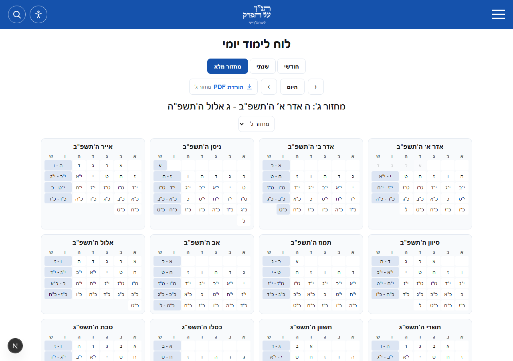
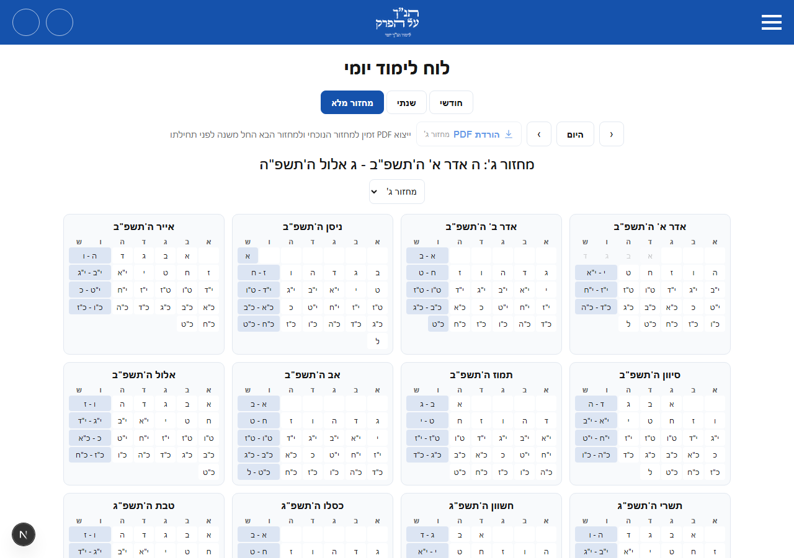
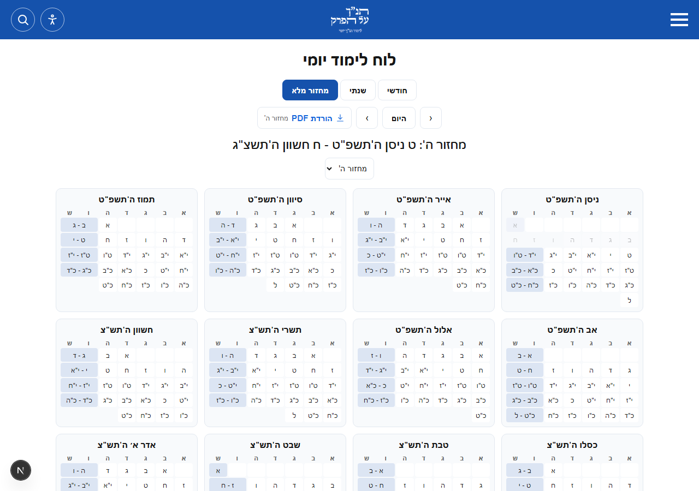
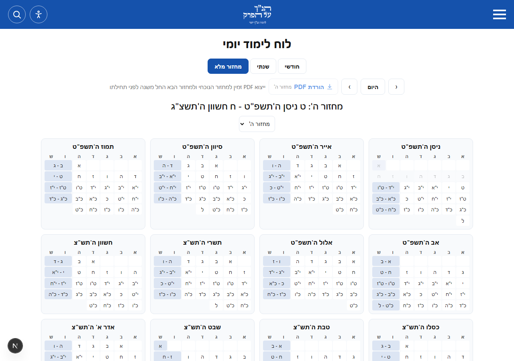
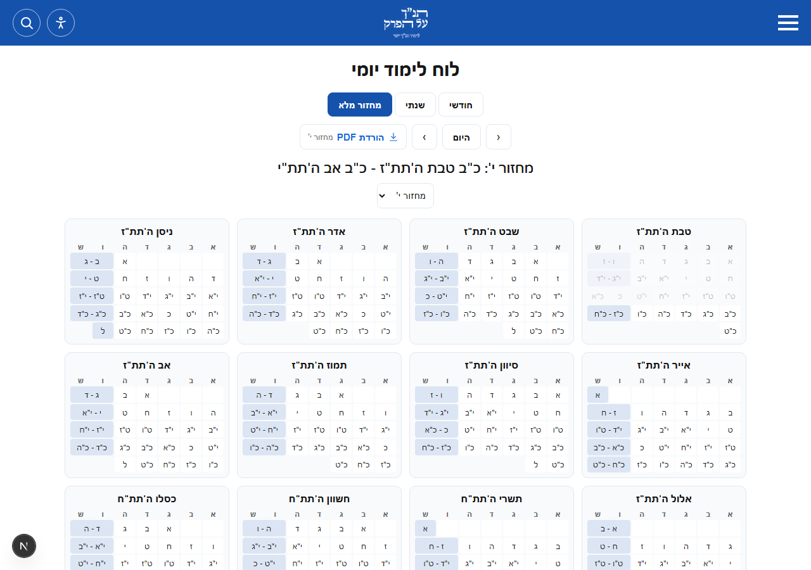

# Calendar cycle limits

Real Chromium captures taken on 2026-10-28. The current cycle is 4, so the
page permits cycles 1-5. Cycle 5 starts 9 Nisan 5789; its export window opens
on 9 Nisan 5788 (inclusive). Cycle 4 remains exportable.

| View | Before | After |
| --- | --- | --- |
| Historical cycle 3 |  |  |
| Next cycle 5 |  |  |
| Far-future shared link for cycle 10 |  |  |

The JSON records list the actual headings, cycle options and export state
observed in each browser view.

The calendar shell is now statically generated; its date and eligibility
refresh in the browser. The scoped production build reports `○ /calendar`.
