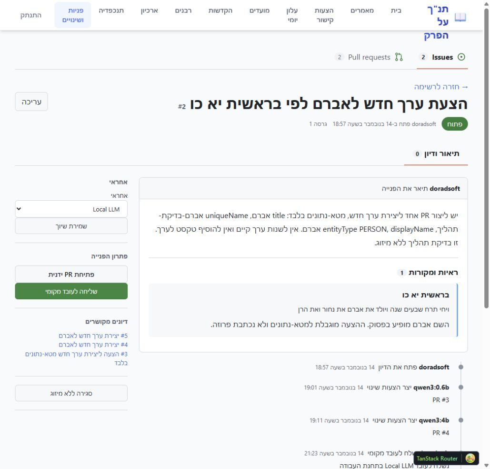
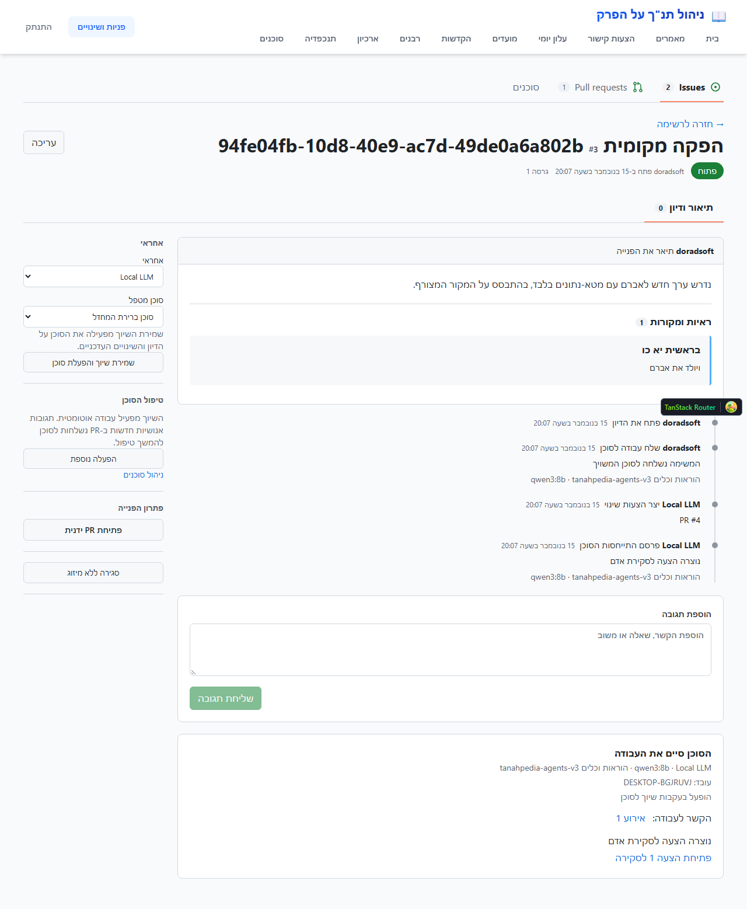

# Assignment-driven agent UI evidence

Real Chromium captures from `tests/e2e/contributions.test.ts`, recorded on 2026-11-15 against an owned Vite server and a disposable `contribution_ui_<UUID>` MySQL schema. The captures were refreshed during the final v3 coverage-enabled run. Only test fixtures were written. The worker used a loopback inference fixture and the actual protocol-2 HTTP endpoints, instruction bundle, discussion tool and completion transaction.

| Before: separate initial generation action | After: assignment triggers implementation |
| --- | --- |
|  |  |

The existing before capture belongs to the preceding contribution workflow. The new captures verify these behaviors:

- [An active comment pass blocks merge](comment-pass-pending.png), including an expired worker lease until the pass is resolved or the PR is unassigned.
- [Same PR after a human comment](comment-resolution.png): the worker reads discussion, revises the existing PR, records its response beside the immutable original comment, and leaves merge disabled pending owner review.
- [Model-authored typed diff](model-pr-review.png): an issue assignment produces a reviewable metadata-only PR, with the existing approval gate.
- [Agent management on desktop](agents-desktop.png) and [mobile](agents-mobile.png): register a versioned configuration on an existing runtime, persist its model/enabled settings, and show current/latest instructions and tools. This UI does not install runtime binaries.
- [Navigation at medium width](navigation-medium.png): management remains reachable without horizontal overflow. Browser assertions also cover widths 390, 812, 1024 and 1280.

Validation: 110 focused component tests and 33 mocked runtime tests passed. The changed contribution components have 98.20% line / 95.46% branch coverage; runtime statements, branches, functions and lines are fully covered. Four browser flows passed in 17.3 seconds; implementation plus comment resolution took 7.0 seconds. The final coverage-enabled browser run also passed all four flows with zero retries in 33.6 seconds and produced nonempty normalized LCOV data. Vite production build and TypeScript validation passed. No interaction deadlines or retries changed.

Real workstation inference also passed with Ollama `qwen3:8b` on the RTX 4070 Laptop GPU: [issue implementation](real-gpu-issue-pr.png) created one metadata-only PERSON proposal in 29.1 seconds, and [comment resolution](real-gpu-comment-resolution.png) revised that same proposal under instruction/tool bundle v3 in 43.4 seconds. The second run received 6,131 prompt tokens and returned 249 output tokens within the unchanged 120-second deadline and 16K context window. Independent database assertions verified revision 1→2, the requested description edit, unchanged typed sequence and evidence, the immutable original comment and its addressed response, model authorship, required owner review and no canonical content applied. An earlier malformed clarification was rejected; the v3 per-outcome output schema prevents replacement drafts in clarification responses and includes fresh pending feedback directly in the initial context. The synthetic PR stayed unmerged.

Focused browser command (run with an isolated populated test schema/server):

```sh
bun x playwright test tests/e2e/contributions.test.ts --grep "assignment starts|registers and configures|supports all four|keeps queue controls" --workers=1 --reporter=list
```
