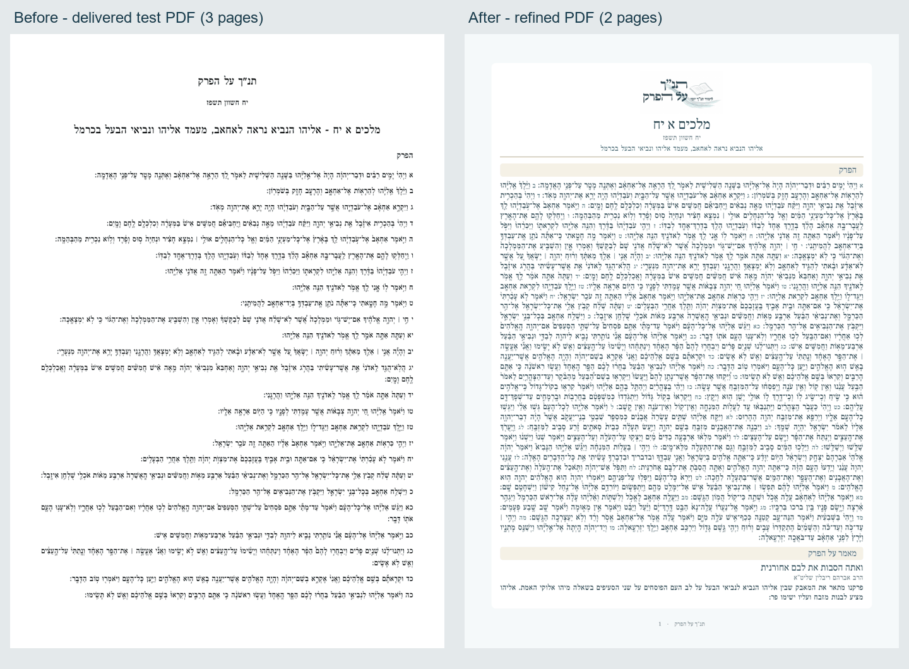

# Daily bulletin PDF

The daily PDF shares the email's original wordmark, navy/teal/gold palette,
compact metadata, justified scripture with inline verse letters, article title
and byline, and project contact icons. Images are embedded from the existing
email assets, so generation needs no network requests. General chapter and book
exports retain their separate layout.

Download names follow the archived bulletin convention:

```text
{chapterId}_{book} {chapterLetters} - {chapterId} - {chapterHeading}.pdf
305_מלכים א יח - 305 - אליהו הנביא נראה לאחאב, מעמד אליהו ונביאי הבעל בכרמל.pdf
```

An absent heading omits its separator. Invalid Windows filename characters are
replaced with spaces, whitespace is collapsed, and the basename is limited to
255 UTF-16 units including `.pdf`. This affects the download name only; stored
content and canonical scripture are preserved. Already prepared bulletins keep
their frozen filename and PDF.

The capture below compares the first page of the delivered October 29 test
bulletin with the same database input rendered by the new template. The complete
chapter and article occupy two pages instead of three. All six upcoming samples
(chapters 305-310) were rendered and every page visually inspected.


